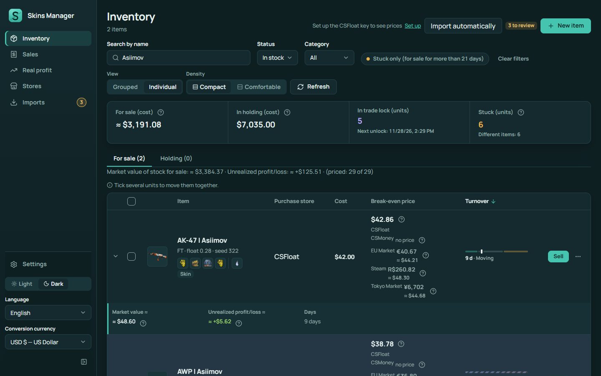
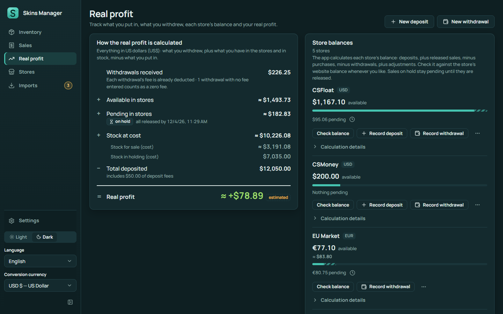
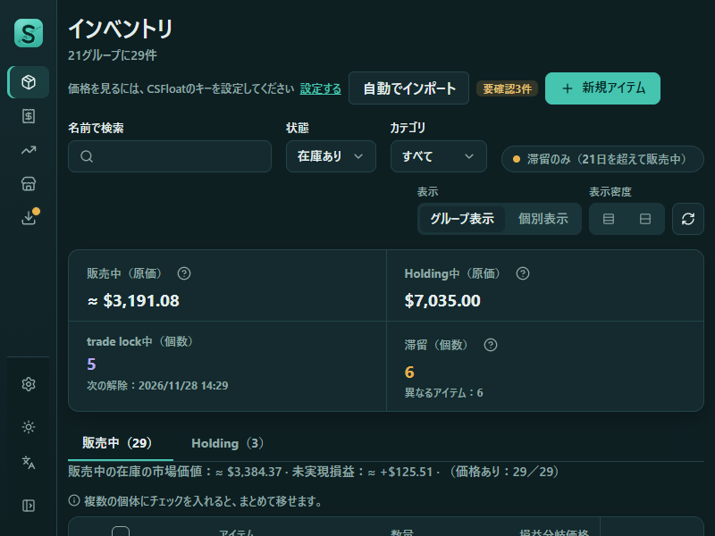
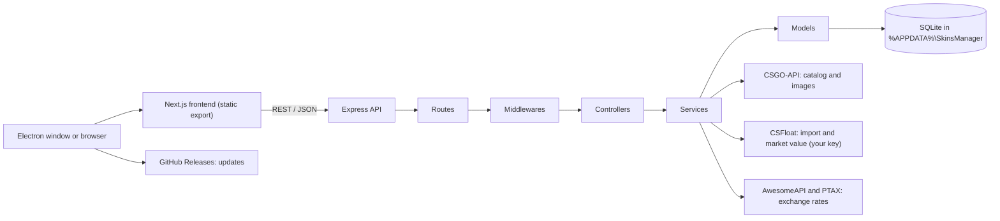

[Deutsch](readme/README.de.md) · **English** · [Español](readme/README.es.md) · [Français](readme/README.fr.md) · [Italiano](readme/README.it.md) · [Polski](readme/README.pl.md) · [Português (Brasil)](readme/README.pt-BR.md) · [Türkçe](readme/README.tr.md) · [Русский](readme/README.ru.md) · [Українська](readme/README.uk.md) · [日本語](readme/README.ja.md) · [简体中文](readme/README.zh-CN.md) · [한국어](readme/README.ko.md)

<p align="center">
  
</p>

<h1 align="center">Skins Manager</h1>

<p align="center">
  Keep track of your CS2 skins: what you paid, the lowest price that still avoids a loss, and what has been sitting too long.
</p>

<p align="center">
  
  
  
</p>

<p align="center">
  <a href="https://github.com/GregoryCardoso/skins-manager/releases/latest"></a>
</p>

<p align="center">
  <picture>
    <source media="(prefers-color-scheme: dark)" srcset="assets/screenshots/hero-inventory-dark.png">
    
  </picture>
</p>

<a id="contents"></a>

## Contents

- [What it is](#about)
- [Features](#features)
- [Screenshots](#screens)
- [Install](#install)
- [Updates](#updates)
- [Your data and backup](#data)
- [Suggestions and problems](#feedback)
- [Development mode](#development)
- [Architecture](#architecture)
- [Credits](#credits)
- [License](#license)

<a id="about"></a>

## What it is

Skins Manager is a **local app** to manage your CS2 inventory: it records what you paid for each item, shows the lowest price you can sell for without a loss, and points out what is not selling. It also keeps your store balances and your real profit.

- Your data stays **only on your computer**, in a database of your own. There is no server and no login.
- It is free for personal use, and every installation is personal.
- It has no connection with Valve and does not touch your Steam account.

<a id="features"></a>

## Features

<!-- demo.gif: the animated demo goes here (assets/screenshots/demo.gif) once the file exists. -->

### Inventory

- **Item catalog with pictures:** pick each item from a list with its name and image instead of typing everything. The catalog comes with the app and can be updated in **Settings**.
- **Float, pattern and phase:** keep the details of each skin, including the phase of Doppler and Gamma Doppler. Items you **received** (free) have a cost of zero.
- **Break-even price:** for each store where you sell, the app works out the lowest price that still covers what you paid, after that store's fee.
- **Trade lock:** see which items are still locked and when they unlock.
- **Turnover:** every item you have for sale is marked as *Recent*, *Moving* or *Stuck*, and you choose the limits in **Settings → Turnover limits**. You can show only the stuck items.
- **Two views:** **Grouped** (one row per item, with quantity, average cost and total cost; expand it to see each unit) or **Individual**. The tabs **For sale** and **Holding** separate what you are selling from what you are keeping on purpose (**Move to holding** and **Put back on sale**; the day count starts again when you put an item back on sale).
- **Search, filters and bulk selection:** search by name, filter by status and category, sort by age and move several units to holding at once.

<p align="center">
  
</p>

### Components and transformations

- **Stickers and charms:** record up to 5 stickers and one charm or Sticker Slab on each weapon, and up to 3 patches on each agent.
- **Apply from stock:** use an item you already own (a sticker, charm or patch) on another one; its cost moves to the item, and real profit and balances do not change. You can undo it.
- **Separate charm/slab:** turn a charm or slab back into its own unit, with the cost split between the two.
- **Open case, capsule, package or terminal:** the cost of what you opened (and of the case's key) moves to the item you get. A terminal can be bought from your Steam store, or recorded as a loss.

<p align="center">
  
</p>

### Selling and Sales

- **Sell** an item in any of your stores: the app shows the break-even price and how much you will receive, and records the profit.
- **Sales page:** profit per sale, the time it took to sell (counted from the end of the trade lock), filters by store and period, and a summary.
- **Undo sale** with a preview of the effect on the store balance.

<p align="center">
  
</p>

### Real profit

- **Store balances are calculated:** deposits, plus released sales, minus purchases, minus withdrawals, plus adjustments. Sales that are still on hold show as pending, with the release dates.
- **Check balance:** type the balance shown on the store's website, see the difference and, if you confirm, record an adjustment with a note.
- **Deposits and withdrawals:** record what you put in and what you took out, with the fee of each withdrawal.
- **The equation:** the **Real profit** page shows how the result is built (withdrawals received, plus what is available and pending in the stores, plus the stock at cost, minus the total deposited). The stock is split into **Stock for sale (cost)** and **Stock in holding (cost)**. Everything is counted in US dollars.

<p align="center">
  
</p>

### Market value (optional)

- With a CSFloat API key, the app fetches the CSFloat reference price of your items when it opens (at most every 15 minutes) and shows the **market value** and the **unrealized profit/loss** in the inventory, in **Holding** and on the **Real profit** page.
- It is only an **estimate** and is **not part of the real profit**: it does not change the break-even price or the stock cost.

<p align="center">
  
</p>

### Import from CSFloat (optional)

- In **Settings → Integrations**, paste your CSFloat API key (it stays on this computer and is not included in backups) and use **Import now**. The app brings in your purchases, sales, deposits and withdrawals.
- What the app cannot be sure about goes to **Imports → To review**, where you link, create, keep or ignore each entry. **Full scan** reads the whole history again, nothing is duplicated, and **Undo import** reverts a batch.
- You can turn on **Import when the app opens**.

<p align="center">
  
</p>

### Stores

- Create the stores you use, in any of the **42 currencies**, each with its sale fee (percentage, minimum and fixed fee, deducted from the price or added to it), rounding, withdrawal fees and balance hold after a sale.
- **Selling on this store** chooses where each item's break-even price appears. On a new installation only CSFloat sells; Steam and CSMoney come as buy-only stores.

<p align="center">
  
</p>

### Languages, currencies and settings

- **13 languages:** English, Português (Brasil), Español, Français, Italiano, Deutsch, Polski, Türkçe, Русский, Українська, 日本語, 简体中文 and 한국어. Item names also appear in your language (the English name is what is stored). English and Portuguese were written by hand; the other 11 were translated with AI and may have mistakes.
- **Conversion currency:** your balance and profit are always counted in US dollars, and you choose one of 42 currencies for the values marked with "≈". A new installation starts in US dollars, with no "≈" values.
- **Exchange rates:** type the rate for any currency, or use **Update rate**. The automatic rate comes from AwesomeAPI (real time), and for the Brazilian real you can choose the central bank's PTAX instead. Other currencies are updated by AwesomeAPI where it supports them, or typed by you.
- **Light and dark themes**, keyboard navigation, and a layout that adapts to small windows.
- **Backup**, **automatic updates** and the data folder are explained below.

<p align="center">
  
</p>

<a id="screens"></a>

## Screenshots

The screenshots are in English; the app is in your language.

<table>
  <tr>
    <td><br><sub>Inventory (dark theme)</sub></td>
    <td><br><sub>Inventory (light theme)</sub></td>
  </tr>
  <tr>
    <td><br><sub>Individual view with float, pattern and trade lock</sub></td>
    <td><br><sub>Adding an item from the catalog</sub></td>
  </tr>
  <tr>
    <td><br><sub>Selling: break-even price and net amount</sub></td>
    <td><br><sub>Sales and time to sell</sub></td>
  </tr>
  <tr>
    <td><br><sub>Real profit and store balances</sub></td>
    <td><br><sub>Holding and market value</sub></td>
  </tr>
  <tr>
    <td><br><sub>Stores, fees and currencies</sub></td>
    <td><br><sub>Import from CSFloat</sub></td>
  </tr>
  <tr>
    <td><br><sub>Language, conversion currency and settings</sub></td>
    <td><br><sub>A small window, in Japanese</sub></td>
  </tr>
</table>

<a id="install"></a>

## Install

There are two ways. Your data is the same in both.

### Option 1: Windows app (recommended)

Nothing else to install.

1. Open the latest version page: <https://github.com/GregoryCardoso/skins-manager/releases/latest>
2. Under **Assets**, download **one** of these files:

   | File | For whom |
   | --- | --- |
   | `SkinsManager-Setup-<version>.exe` | **Installer (recommended).** Installs the app, adds shortcuts to the desktop and Start menu, and updates itself (always asking first). It does not ask for an administrator password. |
   | `SkinsManager-Portable-<version>.exe` | **Portable.** Installs nothing: just double-click the file. It takes a bit longer to open and does not update itself; it only tells you when a new version is out. |

   The other files on that page (`latest.yml` and `.blockmap`) are used by automatic updates. You don't need them.
3. Double-click the downloaded file.
4. **If you see "Windows protected your PC":** click **More info** and then **Run anyway**.
   This warning appears because the app does not have a paid digital signature, not because it has a virus. It may come back with each new version.
   Download the app **only** from the official page above, never from other sites.

### Option 2: in the browser, from the code

For those who prefer to use the app in a browser tab.

1. Install **Node.js**, **LTS** version, from <https://nodejs.org> (just follow the installer with the default options).
2. On the latest version page (<https://github.com/GregoryCardoso/skins-manager/releases/latest>), under **Assets**, download **Source code (zip)**.
3. Right-click the downloaded file and choose **Extract All**. Pick a permanent folder (for example, `Documents`).
4. Open the extracted folder and double-click **`start-app.bat`**.
   - The first time, it downloads what it needs and sets the app up. This needs internet and may take a few minutes.
   - After that, the app opens by itself in the browser, at `http://localhost:3001`.
5. To close the app, close the black `start-app.bat` window.

> Don't open the Windows app and `start-app.bat` at the same time: both use the same data, and only one can be open.

<a id="updates"></a>

## Updates

You can see your version in **Settings → About**.

- **Installer:** a few seconds after opening, the app looks for a new version. You can also check with the **Check for updates** button in **Settings → About**. If there is one, a window shows what changed:
  1. **Download and install** or **Not now** (with "Not now", it asks again the next time you open the app). While it downloads, **Keep using the app** hides the window and the progress stays on the taskbar;
  2. after the download: **Restart and install** or **Install when closing the app**.
     If you close the window without choosing, nothing is installed: the update is offered again the next time the app opens (the file already downloaded is reused). To see the window again, use **Check for updates**.

  Nothing is downloaded or installed without your answer, and your data is kept.
- **Portable:** the app tells you about the new version, and the **Open download page** button takes you to the right page. Download the new file and use it instead of the old one.
- **In the browser:** the app does not look for new versions. Download the new version's **Source code (zip)**, extract it to a new folder and use its `start-app.bat`. Your data stays in `%APPDATA%\SkinsManager`; you can then delete the old folder.

<a id="data"></a>

## Your data and backup

- It stays **only on your computer**. Nothing is sent to anyone. The only things that go online are what you ask for: the item catalog and its pictures, exchange rates, the CSFloat features (with your own key) and the check for updates.
- The folder is `%APPDATA%\SkinsManager` (usually `C:\Users\<your user>\AppData\Roaming\SkinsManager`). The installer, the portable version and `start-app.bat` all use this same folder.
- **Back up:** in **Settings → Backup**, click **Export backup**. Keep the file somewhere safe (a USB drive or the cloud, for example) and don't share it: it contains all your data.
- **Restore:** in **Settings → Backup**, click **Import backup** and choose the file. The app shows a preview (date, data version and how many items, sales, stores, deposits and withdrawals it has), and only when you click **Replace my data** are your data replaced. Before that, the app keeps a copy of your current data.
- The app also makes automatic copies before importing a backup and before updating your data for a new version, and keeps the 10 most recent of each kind. The **Open folder** button, in **Settings → Backup**, shows where they are.
- **Uninstalling does not delete your data.** If you install again, everything is still there. To delete everything for good, remove the `%APPDATA%\SkinsManager` folder (make a backup first if you want to keep anything).

<a id="feedback"></a>

## Suggestions and problems

Found a bug, a translation mistake or have an idea? Open an **Issue**: <https://github.com/GregoryCardoso/skins-manager/issues> (there are ready-made forms in Portuguese and English).
Don't attach your backup file, because it contains your personal data.
Pull requests are not accepted at the moment.

<a id="development"></a>

## Development mode

<details>
<summary>For people who want to run the code and change it</summary>

Requirements: Windows, **Node.js 20 or newer** and PowerShell. In PowerShell, use `npm.cmd` instead of `npm` if scripts are blocked.

```powershell
npm.cmd run install:all     # installs the root, backend and frontend dependencies
npm.cmd run dev             # frontend on http://localhost:3000 and API on http://localhost:3001
```

- **Example database:** `npm.cmd run seed:dev` creates a throwaway database with fictional data in `backend\data\inventory.dev.sqlite`, and `npm.cmd run dev:demo` runs the app on it. It never opens your real database.
- **Desktop app (Electron):** `npm.cmd run desktop:install` once, then `npm.cmd run desktop:dev`. `npm.cmd run desktop:dist` builds the installers.
- **Tests:** `npm.cmd run test:all` runs the backend (Jest and Supertest), the frontend (Vitest) and the desktop (Jest) suites.
- **Settings:** the variables of `backend\.env.example` are only for development and tests (for example, `DB_PATH` points to another database). Normal users never edit them: personal settings live in the app.

</details>

<a id="architecture"></a>

## Architecture

<details>
<summary>How the app is built</summary>



- **Backend:** Node.js and Express, in layers: routes, middlewares, controllers (thin), services (all the business rules, mostly pure functions that receive the current time as a parameter) and models (only SQL).
- **Database:** SQLite through `better-sqlite3`, with versioned migrations. Updating the app never deletes or corrupts data, and a backup is made before each migration.
- **Frontend:** Next.js (App Router, TypeScript) with `output: 'export'`: static pages, no server rendering. All logic lives in the backend, and the screens refresh by themselves when data changes.
- **Desktop:** Electron with electron-builder (installer and portable) and electron-updater (GitHub Releases). It uses a free port from 3001 to 3010.
- **Local security:** the API only accepts requests whose `Host` is `localhost` or `127.0.0.1`, and every route that changes data requires `Content-Type: application/json`, to protect you from other pages open in your browser.
- Money is stored in integer cents, and dates in ISO 8601 (UTC).

</details>

<a id="credits"></a>

## Credits

The item catalog and images come from [CSGO-API](https://github.com/ByMykel/CSGO-API), by ByMykel.
This project is not affiliated with Valve.

<a id="license"></a>

## License

The app is **free for personal use**. The code belongs to the author: **all rights reserved**.
