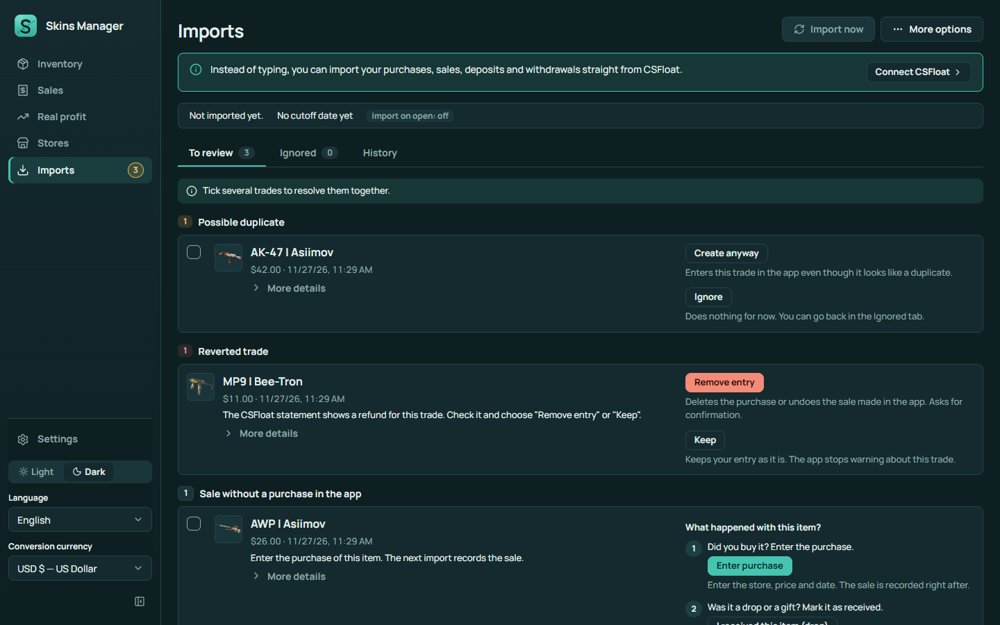
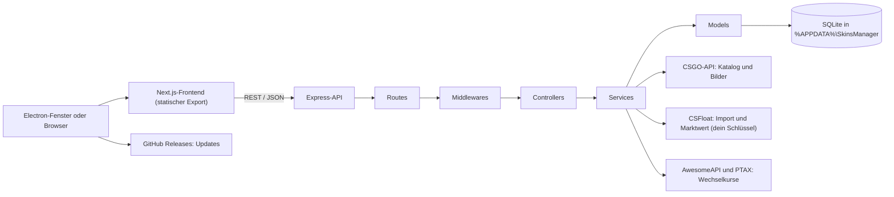

**Deutsch** · [English](../README.md) · [Español](README.es.md) · [Français](README.fr.md) · [Italiano](README.it.md) · [Polski](README.pl.md) · [Português (Brasil)](README.pt-BR.md) · [Türkçe](README.tr.md) · [Русский](README.ru.md) · [Українська](README.uk.md) · [日本語](README.ja.md) · [简体中文](README.zh-CN.md) · [한국어](README.ko.md)

> Diese Übersetzung wurde mit KI erstellt und kann Fehler enthalten. Wenn du welche findest, melde sie bitte in den [Issues](https://github.com/GregoryCardoso/skins-manager/issues).

<p align="center">
  
</p>

<h1 align="center">Skins Manager</h1>

<p align="center">
  Behalte deine CS2-Skins im Blick: was du bezahlt hast, den niedrigsten Preis ohne Verlust und was schon zu lange liegt.
</p>

<p align="center">
  
  
  
</p>

<p align="center">
  <a href="https://github.com/GregoryCardoso/skins-manager/releases/latest"></a>
</p>

<p align="center">
  <picture>
    <source media="(prefers-color-scheme: dark)" srcset="../assets/screenshots/hero-inventory-dark.png">
    
  </picture>
</p>

<a id="contents"></a>

## Inhalt

- [Was es ist](#about)
- [Funktionen](#features)
- [Screenshots](#screens)
- [Installation](#install)
- [Updates](#updates)
- [Deine Daten und das Backup](#data)
- [Vorschläge und Probleme](#feedback)
- [Entwicklungsmodus](#development)
- [Architektur](#architecture)
- [Danksagung](#credits)
- [Lizenz](#license)

<a id="about"></a>

## Was es ist

Skins Manager ist eine **lokale App**, um dein CS2-Inventar zu verwalten: Sie hält fest, was du für jedes Item bezahlt hast, zeigt den niedrigsten Preis, zu dem du ohne Verlust verkaufen kannst, und weist auf alles hin, was sich nicht verkauft. Außerdem führt sie das Guthaben deiner Shops und deinen echten Gewinn.

- Deine Daten bleiben **nur auf deinem Computer**, in einer eigenen Datenbank. Es gibt keinen Server und kein Login.
- Sie ist für den persönlichen Gebrauch kostenlos, und jede Installation ist persönlich.
- Sie hat keine Verbindung zu Valve und berührt dein Steam-Konto nicht.

<a id="features"></a>

## Funktionen

<!-- demo.gif: the animated demo goes here (assets/screenshots/demo.gif) once the file exists. -->

### Inventar

- **Item-Katalog mit Bildern:** Wähle jedes Item aus einer Liste mit Namen und Bild, statt alles von Hand einzutippen. Der Katalog wird mit der App geliefert und lässt sich in den **Einstellungen** aktualisieren.
- **Float, Pattern und Phase:** Speichere die Details jedes Skins, auch die Phase der Doppler und Gamma Doppler. Items, die du **geschenkt** bekommen hast (kostenlos), haben Kosten von null.
- **Preis ohne Verlust:** Für jeden Shop, in dem du verkaufst, berechnet die App den niedrigsten Preis, der nach der Gebühr dieses Shops noch deine Kosten deckt.
- **Trade lock:** Sieh, welche Items noch gesperrt sind und wann sie freigegeben werden.
- **Umschlag:** Jedes Item im Verkauf wird als *Neu*, *In Bewegung* oder *Ladenhüter* markiert, und die Grenzen legst du unter **Einstellungen → Umschlaglimits** fest. Du kannst nur die Ladenhüter anzeigen.
- **Zwei Ansichten:** **Gruppiert** (eine Zeile pro Item, mit Menge, durchschnittlichen Kosten und Gesamtkosten; klappe sie auf, um jede Einheit zu sehen) oder **Einzeln**. Die Tabs **Im Verkauf** und **Holding** trennen, was du verkaufst, von dem, was du absichtlich behältst (**Ins Holding verschieben** und **Wieder in den Verkauf**; die Tageszählung beginnt von vorn, wenn ein Item wieder in den Verkauf kommt).
- **Suche, Filter und Mehrfachauswahl:** Suche nach Namen, filtere nach Status und Kategorie, sortiere nach Alter und verschiebe mehrere Einheiten auf einmal ins Holding.

<p align="center">
  
</p>

### Komponenten und Umwandlungen

- **Sticker und Anhänger:** Erfasse bis zu 5 Sticker und einen Anhänger oder Sticker Slab pro Waffe sowie bis zu 3 Patches pro Agent.
- **Aus dem Bestand anbringen:** Nutze ein Item, das du schon besitzt (einen Sticker, einen Anhänger oder einen Patch), an einem anderen; seine Kosten gehen auf das Item über, und echter Gewinn und Guthaben ändern sich nicht. Du kannst es rückgängig machen.
- **Anhänger/Slab trennen:** Mache einen Anhänger oder Slab wieder zu einer eigenen Einheit, mit auf beide aufgeteilten Kosten.
- **Kiste, Kapsel, Paket oder Terminal öffnen:** Die Kosten dessen, was du geöffnet hast (und des Schlüssels der Kiste), gehen auf das Item über, das du bekommst. Das Item eines Terminals kann in deinem Steam-Shop gekauft oder als Verlust erfasst werden.

<p align="center">
  
</p>

### Verkaufen und Verkäufe

- **Verkaufen** kannst du ein Item in jedem deiner Shops: Die App zeigt den Preis ohne Verlust und wie viel du bekommst, und erfasst den Gewinn.
- **Seite Verkäufe:** Gewinn pro Verkauf, Verkaufsdauer (ab dem Ende des Trade lock gezählt), Filter nach Shop und Zeitraum sowie eine Zusammenfassung.
- **Verkauf rückgängig** mit einer Vorschau der Auswirkung auf das Guthaben des Shops.

<p align="center">
  
</p>

### Echter Gewinn

- **Das Guthaben der Shops wird berechnet:** Einzahlungen, plus freigegebene Verkäufe, minus Käufe, minus Auszahlungen, plus Korrekturen. Verkäufe, die noch zurückgehalten werden, erscheinen als ausstehend, mit den Freigabedaten.
- **Guthaben prüfen:** Gib das Guthaben ein, das die Website des Shops anzeigt, sieh die Differenz und erfasse, wenn du bestätigst, eine Korrektur mit Notiz.
- **Einzahlungen und Auszahlungen:** Erfasse, was du eingezahlt und was du entnommen hast, mit der Gebühr jeder Auszahlung.
- **Die Gleichung:** Die Seite **Echter Gewinn** zeigt, wie sich das Ergebnis zusammensetzt (erhaltene Auszahlungen, plus das Verfügbare und Ausstehende in den Shops, plus der Bestand zu Kosten, minus die insgesamt eingezahlte Summe). Der Bestand teilt sich in **Bestand im Verkauf (Kosten)** und **Bestand im Holding (Kosten)**. Alles wird in US-Dollar gerechnet.

<p align="center">
  
</p>

### Marktwert (optional)

- Mit einem CSFloat-API-Schlüssel holt die App beim Öffnen den CSFloat-Referenzpreis deiner Items (höchstens alle 15 Minuten) und zeigt den **Marktwert** und den **nicht realisierten Gewinn/Verlust** im Inventar, im **Holding** und auf der Seite **Echter Gewinn**.
- Das ist nur eine **Schätzung** und **kein Teil des echten Gewinns**: Sie ändert weder den Preis ohne Verlust noch die Bestandskosten.

<p align="center">
  
</p>

### Import aus CSFloat (optional)

- Füge unter **Einstellungen → Integrationen** deinen CSFloat-API-Schlüssel ein (er bleibt auf diesem Computer und ist nicht in Backups enthalten) und nutze **Jetzt importieren**. Die App holt deine Käufe, Verkäufe, Einzahlungen und Auszahlungen.
- Was die App nicht sicher zuordnen kann, landet unter **Importe → Zu prüfen**, wo du jeden Eintrag verknüpfst, anlegst, behältst oder ignorierst. **Vollscan** liest den gesamten Verlauf noch einmal, ohne etwas doppelt anzulegen, und **Import rückgängig machen** macht einen Stapel rückgängig.
- Du kannst **Beim Öffnen der App importieren** einschalten.

<p align="center">
  
</p>

### Shops

- Lege die Shops an, die du nutzt, in einer beliebigen der **42 Währungen**, jeweils mit eigener Verkaufsgebühr (Prozentsatz, Minimum und Fixgebühr, vom Preis abgezogen oder darauf aufgeschlagen), Rundung, Auszahlungsgebühren und Haltefrist des Guthabens nach einem Verkauf.
- **Ich verkaufe in diesem Shop** legt fest, wo der Preis ohne Verlust jedes Items erscheint. Bei einer neuen Installation verkauft nur CSFloat; Steam und CSMoney sind als reine Kauf-Shops angelegt.

<p align="center">
  
</p>

### Sprachen, Währungen und Einstellungen

- **13 Sprachen:** English, Português (Brasil), Español, Français, Italiano, Deutsch, Polski, Türkçe, Русский, Українська, 日本語, 简体中文 und 한국어. Auch die Item-Namen erscheinen in deiner Sprache (gespeichert wird der englische Name). Englisch und Portugiesisch wurden von Hand geschrieben; die anderen 11 wurden mit KI übersetzt und können Fehler enthalten.
- **Umrechnungswährung:** Dein Guthaben und dein Gewinn werden immer in US-Dollar gerechnet, und du wählst eine von 42 Währungen für die mit „≈“ gekennzeichneten Werte. Eine neue Installation startet in US-Dollar, ohne „≈“-Werte.
- **Wechselkurse:** Gib den Kurs einer beliebigen Währung ein oder nutze **Kurs aktualisieren**. Der automatische Kurs kommt von AwesomeAPI (Echtzeit), und für den brasilianischen Real kannst du stattdessen die PTAX der Zentralbank wählen. Die übrigen Währungen aktualisiert AwesomeAPI, wo sie sie unterstützt, oder du gibst sie selbst ein.
- **Helles und dunkles Design**, Tastaturbedienung und ein Layout, das sich kleinen Fenstern anpasst.
- **Backup**, **automatische Updates** und der Datenordner werden weiter unten erklärt.

<p align="center">
  
</p>

<a id="screens"></a>

## Screenshots

Die Screenshots sind auf Englisch; die App ist in deiner Sprache.

<table>
  <tr>
    <td><br><sub>Inventar (dunkles Design)</sub></td>
    <td><br><sub>Inventar (helles Design)</sub></td>
  </tr>
  <tr>
    <td><br><sub>Einzelansicht mit Float, Pattern und Trade lock</sub></td>
    <td><br><sub>Ein Item aus dem Katalog hinzufügen</sub></td>
  </tr>
  <tr>
    <td><br><sub>Verkaufen: Preis ohne Verlust und Nettobetrag</sub></td>
    <td><br><sub>Verkäufe und Verkaufsdauer</sub></td>
  </tr>
  <tr>
    <td><br><sub>Echter Gewinn und Guthaben der Shops</sub></td>
    <td><br><sub>Holding und Marktwert</sub></td>
  </tr>
  <tr>
    <td><br><sub>Shops, Gebühren und Währungen</sub></td>
    <td><br><sub>Import aus CSFloat</sub></td>
  </tr>
  <tr>
    <td><br><sub>Sprache, Umrechnungswährung und Einstellungen</sub></td>
    <td><br><sub>Ein kleines Fenster, auf Japanisch</sub></td>
  </tr>
</table>

<a id="install"></a>

## Installation

Es gibt zwei Wege. Deine Daten sind bei beiden dieselben.

### Option 1: Windows-App (empfohlen)

Es muss nichts weiter installiert werden.

1. Öffne die Seite der neuesten Version: <https://github.com/GregoryCardoso/skins-manager/releases/latest>
2. Lade unter **Assets** **eine** dieser Dateien herunter:

   | Datei | Für wen |
   | --- | --- |
   | `SkinsManager-Setup-<Version>.exe` | **Installer (empfohlen).** Installiert die App, legt Verknüpfungen auf dem Desktop und im Startmenü an und aktualisiert sich selbst (fragt immer vorher nach). Er verlangt kein Administratorkennwort. |
   | `SkinsManager-Portable-<Version>.exe` | **Portabel.** Installiert nichts: Du musst nur doppelt auf die Datei klicken. Sie braucht etwas länger zum Öffnen und aktualisiert sich nicht selbst; sie sagt dir nur Bescheid, wenn eine neue Version erscheint. |

   Die anderen Dateien auf dieser Seite (`latest.yml` und `.blockmap`) werden von den automatischen Updates verwendet. Du brauchst sie nicht.
3. Doppelklicke auf die heruntergeladene Datei.
4. **Wenn „Der Computer wurde durch Windows geschützt“ (Windows protected your PC) erscheint:** Klicke auf **Weitere Informationen** und dann auf **Trotzdem ausführen**.
   Diese Warnung erscheint, weil die App keine kostenpflichtige digitale Signatur hat, nicht weil sie einen Virus enthält. Sie kann bei jeder neuen Version wiederkommen.
   Lade die App **nur** von der offiziellen Seite oben herunter, niemals von anderen Websites.

### Option 2: im Browser, aus dem Code

Für alle, die die App lieber in einem Browser-Tab nutzen.

1. Installiere **Node.js**, **LTS**-Version, von <https://nodejs.org> (folge einfach dem Installer mit den Standardoptionen).
2. Lade auf der Seite der neuesten Version (<https://github.com/GregoryCardoso/skins-manager/releases/latest>) unter **Assets** **Source code (zip)** herunter.
3. Klicke mit der rechten Maustaste auf die heruntergeladene Datei und wähle **Alle extrahieren**. Wähle einen dauerhaften Ordner (zum Beispiel `Dokumente`).
4. Öffne den entpackten Ordner und doppelklicke auf **`start-app.bat`**.
   - Beim ersten Mal lädt er herunter, was er braucht, und richtet die App ein. Dafür ist Internet nötig, und es kann ein paar Minuten dauern.
   - Danach öffnet sich die App von selbst im Browser, unter `http://localhost:3001`.
5. Zum Beenden der App schließt du das schwarze Fenster von `start-app.bat`.

> Öffne die Windows-App und `start-app.bat` nicht gleichzeitig: Beide nutzen dieselben Daten, und nur eine von beiden kann geöffnet sein.

<a id="updates"></a>

## Updates

Deine Version siehst du unter **Einstellungen → Info**.

- **Installer:** Wenige Sekunden nach dem Öffnen sucht die App nach einer neuen Version. Du kannst auch mit dem Button **Nach Updates suchen** unter **Einstellungen → Info** suchen. Gibt es eine, zeigt ein Fenster, was sich geändert hat:
  1. **Herunterladen und installieren** oder **Jetzt nicht** (bei „Jetzt nicht“ fragt die App beim nächsten Öffnen erneut). Während des Downloads blendet **App weiter nutzen** das Fenster aus, und der Fortschritt bleibt in der Taskleiste;
  2. nach dem Download: **Neu starten und installieren** oder **Beim Schließen der App installieren**.
     Wenn du das Fenster schließt, ohne etwas zu wählen, wird nichts installiert: Das Update wird beim nächsten Öffnen der App erneut angeboten (die bereits heruntergeladene Datei wird wiederverwendet). Um das Fenster nochmal zu sehen, nutze **Nach Updates suchen**.

  Ohne deine Antwort wird nichts heruntergeladen oder installiert, und deine Daten bleiben erhalten.
- **Portabel:** Die App weist dich auf die neue Version hin, und der Button **Download-Seite öffnen** führt dich zur richtigen Seite. Lade die neue Datei herunter und nutze sie anstelle der alten.
- **Im Browser:** Die App sucht nicht nach neuen Versionen. Lade den **Source code (zip)** der neuen Version herunter, entpacke ihn in einen neuen Ordner und nutze dessen `start-app.bat`. Deine Daten bleiben in `%APPDATA%\SkinsManager`; den alten Ordner kannst du danach löschen.

<a id="data"></a>

## Deine Daten und das Backup

- Sie bleiben **nur auf deinem Computer**. Es wird nichts an jemanden gesendet. Ins Internet geht nur, was du selbst anforderst: der Item-Katalog und seine Bilder, die Wechselkurse, die CSFloat-Funktionen (mit deinem eigenen Schlüssel) und die Suche nach Updates.
- Der Ordner ist `%APPDATA%\SkinsManager` (normalerweise `C:\Users\<dein Benutzer>\AppData\Roaming\SkinsManager`). Der Installer, die portable Version und `start-app.bat` nutzen genau diesen Ordner.
- **Sichern:** Klicke unter **Einstellungen → Backup** auf **Backup exportieren**. Bewahre die Datei an einem sicheren Ort auf (zum Beispiel auf einem USB-Stick oder in der Cloud) und gib sie nicht weiter: Sie enthält alle deine Daten.
- **Wiederherstellen:** Klicke unter **Einstellungen → Backup** auf **Backup importieren** und wähle die Datei. Die App zeigt eine Vorschau (Datum, Datenversion und wie viele Items, Verkäufe, Shops, Einzahlungen und Auszahlungen sie enthält), und erst wenn du auf **Meine Daten ersetzen** klickst, werden deine Daten ersetzt. Davor legt die App eine Kopie deiner aktuellen Daten an.
- Die App macht außerdem automatische Kopien vor dem Import eines Backups und vor der Aktualisierung deiner Daten für eine neue Version und behält jeweils die 10 neuesten jeder Art. Der Button **Ordner öffnen** unter **Einstellungen → Backup** zeigt, wo sie liegen.
- **Deinstallieren löscht deine Daten nicht.** Wenn du neu installierst, ist alles noch da. Um alles endgültig zu löschen, entferne den Ordner `%APPDATA%\SkinsManager` (mach vorher ein Backup, wenn du etwas behalten willst).

<a id="feedback"></a>

## Vorschläge und Probleme

Du hast einen Fehler, einen Übersetzungsfehler gefunden oder eine Idee? Eröffne ein **Issue**: <https://github.com/GregoryCardoso/skins-manager/issues> (es gibt fertige Formulare auf Portugiesisch und Englisch).
Hänge deine Backup-Datei nicht an, denn sie enthält deine persönlichen Daten.
Pull Requests werden derzeit nicht angenommen.

<a id="development"></a>

## Entwicklungsmodus

<details>
<summary>Für alle, die den Code ausführen und ändern möchten</summary>

Voraussetzungen: Windows, **Node.js 20 oder neuer** und PowerShell. Nutze in PowerShell `npm.cmd` statt `npm`, wenn Skripte blockiert sind.

```powershell
npm.cmd run install:all     # installiert die Abhängigkeiten von Root, Backend und Frontend
npm.cmd run dev             # Frontend auf http://localhost:3000 und API auf http://localhost:3001
```

- **Beispieldatenbank:** `npm.cmd run seed:dev` erstellt eine Wegwerf-Datenbank mit fiktiven Daten in `backend\data\inventory.dev.sqlite`, und `npm.cmd run dev:demo` startet die App damit. Deine echte Datenbank wird dabei nie geöffnet.
- **Desktop-App (Electron):** einmal `npm.cmd run desktop:install`, danach `npm.cmd run desktop:dev`. `npm.cmd run desktop:dist` erstellt die Installer.
- **Tests:** `npm.cmd run test:all` führt die Suites für Backend (Jest und Supertest), Frontend (Vitest) und Desktop (Jest) aus.
- **Konfiguration:** Die Variablen in `backend\.env.example` sind nur für Entwicklung und Tests gedacht (zum Beispiel zeigt `DB_PATH` auf eine andere Datenbank). Normale Nutzer bearbeiten sie nie: Die persönlichen Einstellungen liegen in der App.

</details>

<a id="architecture"></a>

## Architektur

<details>
<summary>Wie die App aufgebaut ist</summary>



- **Backend:** Node.js und Express, in Schichten: Routes, Middlewares, Controllers (schlank), Services (die gesamte Geschäftslogik, meist reine Funktionen, die die aktuelle Uhrzeit als Parameter erhalten) und Models (nur SQL).
- **Datenbank:** SQLite über `better-sqlite3`, mit versionierten Migrationen. Ein Update der App löscht oder beschädigt nie Daten, und vor jeder Migration wird ein Backup angelegt.
- **Frontend:** Next.js (App Router, TypeScript) mit `output: 'export'`: statische Seiten, kein Server-Rendering. Die gesamte Logik liegt im Backend, und die Bildschirme aktualisieren sich von selbst, wenn sich Daten ändern.
- **Desktop:** Electron mit electron-builder (Installer und portabel) und electron-updater (GitHub Releases). Es nutzt einen freien Port von 3001 bis 3010.
- **Lokale Sicherheit:** Die API akzeptiert nur Anfragen, deren `Host` `localhost` oder `127.0.0.1` ist, und jede Route, die Daten ändert, verlangt `Content-Type: application/json`, um dich vor anderen im Browser geöffneten Seiten zu schützen.
- Geld wird in ganzzahligen Cent gespeichert, Datumsangaben in ISO 8601 (UTC).

</details>

<a id="credits"></a>

## Danksagung

Der Item-Katalog und die Bilder stammen von [CSGO-API](https://github.com/ByMykel/CSGO-API), von ByMykel.
Dieses Projekt steht in keiner Verbindung zu Valve.

<a id="license"></a>

## Lizenz

Die App ist **kostenlos für den persönlichen Gebrauch**. Der Code gehört dem Autor: **alle Rechte vorbehalten**.
