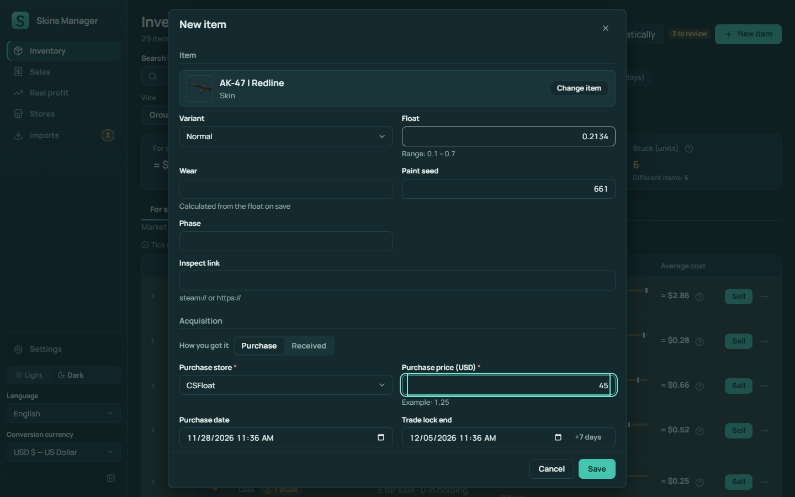
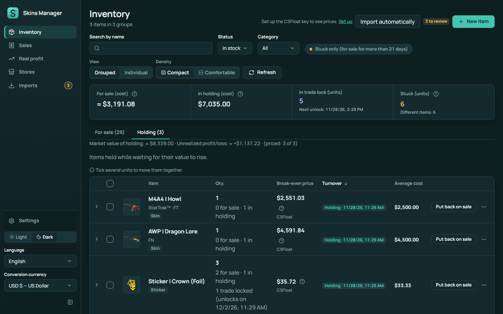
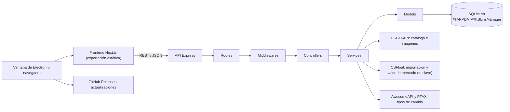

[Deutsch](README.de.md) · [English](../README.md) · **Español** · [Français](README.fr.md) · [Italiano](README.it.md) · [Polski](README.pl.md) · [Português (Brasil)](README.pt-BR.md) · [Türkçe](README.tr.md) · [Русский](README.ru.md) · [Українська](README.uk.md) · [日本語](README.ja.md) · [简体中文](README.zh-CN.md) · [한국어](README.ko.md)

> Esta traducción se hizo con IA y puede tener errores. Si encuentras alguno, avísanos en las [Issues](https://github.com/GregoryCardoso/skins-manager/issues).

<p align="center">
  
</p>

<h1 align="center">Skins Manager</h1>

<p align="center">
  Controla tu inventario de skins de CS2: cuánto pagaste, a qué precio vender sin pérdida y qué lleva demasiado tiempo sin venderse.
</p>

<p align="center">
  
  
  
</p>

<p align="center">
  <a href="https://github.com/GregoryCardoso/skins-manager/releases/latest"></a>
</p>

<p align="center">
  <picture>
    <source media="(prefers-color-scheme: dark)" srcset="../assets/screenshots/hero-inventory-dark.png">
    
  </picture>
</p>

<a id="contents"></a>

## Índice

- [Qué es](#about)
- [Funciones](#features)
- [Capturas](#screens)
- [Instalación](#install)
- [Actualizaciones](#updates)
- [Tus datos y la copia de seguridad](#data)
- [Sugerencias y problemas](#feedback)
- [Modo de desarrollo](#development)
- [Arquitectura](#architecture)
- [Créditos](#credits)
- [Licencia](#license)

<a id="about"></a>

## Qué es

Skins Manager es una **app local** para controlar tu inventario de CS2: registra cuánto pagaste por cada ítem, muestra el precio más bajo al que puedes vender sin perder dinero y señala lo que no se está vendiendo. También lleva el saldo de tus tiendas y tu ganancia real.

- Tus datos se quedan **solo en tu equipo**, en una base de datos propia. No hay servidor ni inicio de sesión.
- Es gratis para uso personal, y cada instalación es personal.
- No tiene ninguna relación con Valve y no toca tu cuenta de Steam.

<a id="features"></a>

## Funciones

<!-- demo.gif: the animated demo goes here (assets/screenshots/demo.gif) once the file exists. -->

### Inventario

- **Catálogo de ítems con imágenes:** elige cada ítem de una lista con su nombre e imagen, en vez de escribirlo todo a mano. El catálogo viene con la app y se puede actualizar en **Configuración**.
- **Float, pattern y fase:** guarda los detalles de cada skin, incluida la fase de las Doppler y Gamma Doppler. Los ítems que **recibiste** (gratis) tienen costo cero.
- **Precio mínimo (sin pérdida):** para cada tienda donde vendes, la app calcula el precio más bajo que aún cubre lo que pagaste, después de la comisión de esa tienda.
- **Trade lock:** mira qué ítems siguen bloqueados y cuándo se desbloquean.
- **Rotación:** cada ítem a la venta se marca como *Reciente*, *En rotación* o *Estancado*, y tú eliges los límites en **Configuración → Límites de rotación**. Puedes mostrar solo los estancados.
- **Dos vistas:** **Agrupado** (una fila por ítem, con cantidad, costo medio y costo total; ábrela para ver cada unidad) o **Individual**. Las pestañas **A la venta** y **Holding** separan lo que estás vendiendo de lo que guardas a propósito (**Mover al holding** y **Volver a la venta**; el conteo de días empieza de nuevo cuando un ítem vuelve a la venta).
- **Búsqueda, filtros y selección en bloque:** busca por nombre, filtra por estado y categoría, ordena por antigüedad y mueve varias unidades al holding a la vez.

<p align="center">
  
</p>

### Componentes y transformaciones

- **Stickers y llaveros:** registra hasta 5 stickers y un llavero o Sticker Slab en cada arma, y hasta 3 parches en cada agente.
- **Aplicar desde el stock:** usa un ítem que ya tienes (un sticker, un llavero o un parche) en otro; su costo pasa al ítem, y la ganancia real y los saldos no cambian. Se puede deshacer.
- **Separar llavero/slab:** convierte de nuevo un llavero o slab en una unidad propia, con el costo dividido entre los dos.
- **Abrir caja, cápsula, paquete o terminal:** el costo de lo que abriste (y de la llave de la caja) pasa al ítem que obtienes. El ítem de un terminal se puede comprar en tu tienda Steam o registrar como pérdida.

<p align="center">
  
</p>

### Venta y Ventas

- **Vender** un ítem en cualquiera de tus tiendas: la app muestra el precio mínimo y cuánto vas a recibir, y registra la ganancia.
- **Página Ventas:** ganancia de cada venta, tiempo hasta vender (contado desde el fin del trade lock), filtros por tienda y período, y un resumen.
- **Deshacer venta** con una vista previa del efecto en el saldo de la tienda.

<p align="center">
  
</p>

### Ganancia real

- **El saldo de las tiendas se calcula:** aportes, más ventas liberadas, menos compras, menos retiros, más ajustes. Las ventas que aún están retenidas aparecen como pendientes, con sus fechas de liberación.
- **Verificar saldo:** escribe el saldo que muestra el sitio de la tienda, mira la diferencia y, si lo confirmas, registra un ajuste con una nota.
- **Aportes y retiros:** registra lo que pusiste y lo que sacaste, con la comisión de cada retiro.
- **La ecuación:** la página **Ganancia real** muestra cómo se forma el resultado (retiros recibidos, más lo disponible y lo pendiente en las tiendas, más el stock al costo, menos el total aportado). El stock se divide en **Stock a la venta (costo)** y **Stock en el holding (costo)**. Todo se cuenta en dólares estadounidenses.

<p align="center">
  
</p>

### Valor de mercado (opcional)

- Con una clave de API de CSFloat, la app busca el precio de referencia de CSFloat de tus ítems al abrirse (como máximo cada 15 minutos) y muestra el **valor de mercado** y la **ganancia/pérdida no realizada** en el inventario, en **Holding** y en la página **Ganancia real**.
- Es solo una **estimación** y **no forma parte de la ganancia real**: no cambia el precio mínimo ni el costo del stock.

<p align="center">
  
</p>

### Importación desde CSFloat (opcional)

- En **Configuración → Integraciones**, pega tu clave de API de CSFloat (se queda en este equipo y no se incluye en las copias de seguridad) y usa **Importar ahora**. La app trae tus compras, ventas, aportes y retiros.
- Lo que la app no puede saber con certeza va a **Importaciones → Por revisar**, donde vinculas, creas, conservas o ignoras cada registro. **Escaneo completo** lee todo el historial de nuevo sin duplicar nada, y **Deshacer importación** revierte un lote.
- Puedes activar **Importar al abrir la app**.

<p align="center">
  
</p>

### Tiendas

- Crea las tiendas que usas, en cualquiera de las **42 monedas**, cada una con su comisión de venta (porcentaje, mínimo y comisión fija, descontada del precio o sumada a él), redondeo, comisiones de retiro y retención del saldo tras una venta.
- **Vendo en esta tienda** elige dónde aparece el precio mínimo de cada ítem. En una instalación nueva solo CSFloat vende; Steam y CSMoney vienen como tiendas solo de compra.

<p align="center">
  
</p>

### Idiomas, monedas y configuración

- **13 idiomas:** English, Português (Brasil), Español, Français, Italiano, Deutsch, Polski, Türkçe, Русский, Українська, 日本語, 简体中文 y 한국어. Los nombres de los ítems también aparecen en tu idioma (lo que se guarda es el nombre en inglés). El inglés y el portugués se escribieron a mano; los otros 11 se tradujeron con IA y pueden tener errores.
- **Moneda de conversión:** tu saldo y tu ganancia se cuentan siempre en dólares estadounidenses, y tú eliges una de 42 monedas para los valores marcados con "≈". Una instalación nueva empieza en dólares, sin valores "≈".
- **Tipos de cambio:** escribe el tipo de cambio de cualquier moneda o usa **Actualizar tipo de cambio**. El tipo automático viene de AwesomeAPI (tiempo real) y, para el real brasileño, puedes elegir en su lugar la PTAX del banco central. Las demás monedas las actualiza AwesomeAPI donde la admite, o las escribes tú.
- **Temas claro y oscuro**, navegación con el teclado y un diseño que se adapta a ventanas pequeñas.
- La **copia de seguridad**, las **actualizaciones automáticas** y la carpeta de datos se explican más abajo.

<p align="center">
  
</p>

<a id="screens"></a>

## Capturas

Las capturas están en inglés; la app está en tu idioma.

<table>
  <tr>
    <td><br><sub>Inventario (tema oscuro)</sub></td>
    <td><br><sub>Inventario (tema claro)</sub></td>
  </tr>
  <tr>
    <td><br><sub>Vista individual, con float, pattern y trade lock</sub></td>
    <td><br><sub>Alta de un ítem desde el catálogo</sub></td>
  </tr>
  <tr>
    <td><br><sub>Venta: precio mínimo e importe neto</sub></td>
    <td><br><sub>Ventas y tiempo hasta vender</sub></td>
  </tr>
  <tr>
    <td><br><sub>Ganancia real y saldos de las tiendas</sub></td>
    <td><br><sub>Holding y valor de mercado</sub></td>
  </tr>
  <tr>
    <td><br><sub>Tiendas, comisiones y monedas</sub></td>
    <td><br><sub>Importación desde CSFloat</sub></td>
  </tr>
  <tr>
    <td><br><sub>Idioma, moneda de conversión y configuración</sub></td>
    <td><br><sub>Una ventana pequeña, en japonés</sub></td>
  </tr>
</table>

<a id="install"></a>

## Instalación

Hay dos formas. Tus datos son los mismos en ambas.

### Opción 1: app para Windows (recomendada)

No hay que instalar nada más.

1. Abre la página de la última versión: <https://github.com/GregoryCardoso/skins-manager/releases/latest>
2. En **Assets**, descarga **uno** de estos archivos:

   | Archivo | Para quién |
   | --- | --- |
   | `SkinsManager-Setup-<versión>.exe` | **Instalador (recomendado).** Instala la app, crea accesos directos en el escritorio y en el menú Inicio, y se actualiza solo (preguntando siempre antes). No pide contraseña de administrador. |
   | `SkinsManager-Portable-<versión>.exe` | **Portátil.** No instala nada: basta con hacer doble clic en el archivo. Tarda un poco más en abrir y no se actualiza solo; solo avisa cuando sale una versión nueva. |

   Los demás archivos de esa página (`latest.yml` y `.blockmap`) los usan las actualizaciones automáticas. No los necesitas.
3. Haz doble clic en el archivo descargado.
4. **Si aparece "Windows protegió su PC" (Windows protected your PC):** haz clic en **Más información** y después en **Ejecutar de todas formas**.
   Este aviso aparece porque la app no tiene una firma digital de pago, no porque tenga un virus. Puede volver a aparecer con cada versión nueva.
   Descarga la app **solo** de la página oficial de arriba, nunca de otros sitios.

### Opción 2: en el navegador, desde el código

Para quien prefiere usar la app en una pestaña del navegador.

1. Instala **Node.js**, versión **LTS**, desde <https://nodejs.org> (basta con seguir el instalador con las opciones predeterminadas).
2. En la página de la última versión (<https://github.com/GregoryCardoso/skins-manager/releases/latest>), en **Assets**, descarga **Source code (zip)**.
3. Haz clic con el botón derecho en el archivo descargado y elige **Extraer todo**. Elige una carpeta permanente (por ejemplo, `Documentos`).
4. Abre la carpeta extraída y haz doble clic en **`start-app.bat`**.
   - La primera vez, descarga lo que necesita y prepara la app. Esto requiere internet y puede tardar unos minutos.
   - Después, la app se abre sola en el navegador, en `http://localhost:3001`.
5. Para cerrar la app, cierra la ventana negra de `start-app.bat`.

> No abras la app para Windows y `start-app.bat` al mismo tiempo: ambos usan los mismos datos, y solo uno puede estar abierto.

<a id="updates"></a>

## Actualizaciones

Puedes ver tu versión en **Configuración → Acerca de**.

- **Instalador:** unos segundos después de abrir, la app busca una versión nueva. También puedes buscarla con el botón **Buscar actualizaciones**, en **Configuración → Acerca de**. Si hay una, una ventana muestra qué cambió:
  1. **Descargar e instalar** o **Ahora no** (con "Ahora no", vuelve a preguntar la próxima vez que abras la app). Mientras descarga, **Seguir usando la app** oculta la ventana y el progreso queda en la barra de tareas;
  2. después de la descarga: **Reiniciar e instalar** o **Instalar al cerrar la app**.
     Si cierras la ventana sin elegir, no se instala nada: la actualización se ofrece de nuevo la próxima vez que se abra la app (se reutiliza el archivo ya descargado). Para ver la ventana otra vez, usa **Buscar actualizaciones**.

  No se descarga ni se instala nada sin tu respuesta, y tus datos se conservan.
- **Portátil:** la app te avisa de la versión nueva, y el botón **Abrir página de descargas** te lleva a la página correcta. Descarga el archivo nuevo y úsalo en lugar del antiguo.
- **En el navegador:** la app no busca versiones nuevas. Descarga el **Source code (zip)** de la versión nueva, extráelo en una carpeta nueva y usa su `start-app.bat`. Tus datos siguen en `%APPDATA%\SkinsManager`; después puedes borrar la carpeta antigua.

<a id="data"></a>

## Tus datos y la copia de seguridad

- Se quedan **solo en tu equipo**. No se envía nada a nadie. Lo único que sale a internet es lo que tú pides: el catálogo de ítems y sus imágenes, los tipos de cambio, las funciones de CSFloat (con tu propia clave) y la búsqueda de actualizaciones.
- La carpeta es `%APPDATA%\SkinsManager` (normalmente `C:\Users\<tu usuario>\AppData\Roaming\SkinsManager`). El instalador, la versión portátil y `start-app.bat` usan esta misma carpeta.
- **Hacer una copia:** en **Configuración → Copia de seguridad**, haz clic en **Exportar copia de seguridad**. Guarda el archivo en un lugar seguro (una memoria USB o la nube, por ejemplo) y no lo compartas: contiene todos tus datos.
- **Restaurar:** en **Configuración → Copia de seguridad**, haz clic en **Importar copia de seguridad** y elige el archivo. La app muestra una vista previa (fecha, versión de los datos y cuántos ítems, ventas, tiendas, aportes y retiros tiene), y tus datos solo se reemplazan cuando haces clic en **Reemplazar mis datos**. Antes de eso, la app guarda una copia de tus datos actuales.
- La app también hace copias automáticas antes de importar una copia de seguridad y antes de actualizar tus datos para una versión nueva, y conserva las 10 más recientes de cada tipo. El botón **Abrir carpeta**, en **Configuración → Copia de seguridad**, muestra dónde están.
- **Desinstalar no borra tus datos.** Si vuelves a instalar, todo sigue ahí. Para borrar todo definitivamente, elimina la carpeta `%APPDATA%\SkinsManager` (haz antes una copia de seguridad si quieres conservar algo).

<a id="feedback"></a>

## Sugerencias y problemas

¿Encontraste un error, un fallo de traducción o tienes una idea? Abre una **Issue**: <https://github.com/GregoryCardoso/skins-manager/issues> (hay formularios preparados en portugués e inglés).
No adjuntes tu archivo de copia de seguridad, porque contiene tus datos personales.
Por ahora no se aceptan pull requests.

<a id="development"></a>

## Modo de desarrollo

<details>
<summary>Para quien quiere ejecutar el código y modificarlo</summary>

Requisitos: Windows, **Node.js 20 o más reciente** y PowerShell. En PowerShell, usa `npm.cmd` en lugar de `npm` si los scripts están bloqueados.

```powershell
npm.cmd run install:all     # instala las dependencias de la raíz, del backend y del frontend
npm.cmd run dev             # frontend en http://localhost:3000 y API en http://localhost:3001
```

- **Base de datos de ejemplo:** `npm.cmd run seed:dev` crea una base de datos desechable con datos ficticios en `backend\data\inventory.dev.sqlite`, y `npm.cmd run dev:demo` ejecuta la app con ella. Nunca abre tu base de datos real.
- **App de escritorio (Electron):** `npm.cmd run desktop:install` una vez, y luego `npm.cmd run desktop:dev`. `npm.cmd run desktop:dist` genera los instaladores.
- **Pruebas:** `npm.cmd run test:all` ejecuta las suites del backend (Jest y Supertest), del frontend (Vitest) y del escritorio (Jest).
- **Configuración:** las variables de `backend\.env.example` son solo para desarrollo y pruebas (por ejemplo, `DB_PATH` apunta a otra base de datos). Los usuarios normales nunca las editan: la configuración personal vive en la app.

</details>

<a id="architecture"></a>

## Arquitectura

<details>
<summary>Cómo está construida la app</summary>



- **Backend:** Node.js y Express, en capas: rutas, middlewares, controllers (delgados), services (toda la lógica de negocio, en general funciones puras que reciben la hora actual como parámetro) y models (solo SQL).
- **Base de datos:** SQLite mediante `better-sqlite3`, con migraciones versionadas. Actualizar la app nunca borra ni corrompe datos, y se hace una copia de seguridad antes de cada migración.
- **Frontend:** Next.js (App Router, TypeScript) con `output: 'export'`: páginas estáticas, sin renderizado en el servidor. Toda la lógica está en el backend, y las pantallas se actualizan solas cuando cambian los datos.
- **Escritorio:** Electron con electron-builder (instalador y portátil) y electron-updater (GitHub Releases). Usa un puerto libre del 3001 al 3010.
- **Seguridad local:** la API solo acepta solicitudes cuyo `Host` sea `localhost` o `127.0.0.1`, y toda ruta que modifica datos exige `Content-Type: application/json`, para protegerte de otras páginas abiertas en tu navegador.
- El dinero se guarda en centavos enteros, y las fechas en ISO 8601 (UTC).

</details>

<a id="credits"></a>

## Créditos

El catálogo de ítems y las imágenes vienen de [CSGO-API](https://github.com/ByMykel/CSGO-API), de ByMykel.
Este proyecto no está afiliado a Valve.

<a id="license"></a>

## Licencia

La app es **gratuita para uso personal**. El código pertenece al autor: **todos los derechos reservados**.
