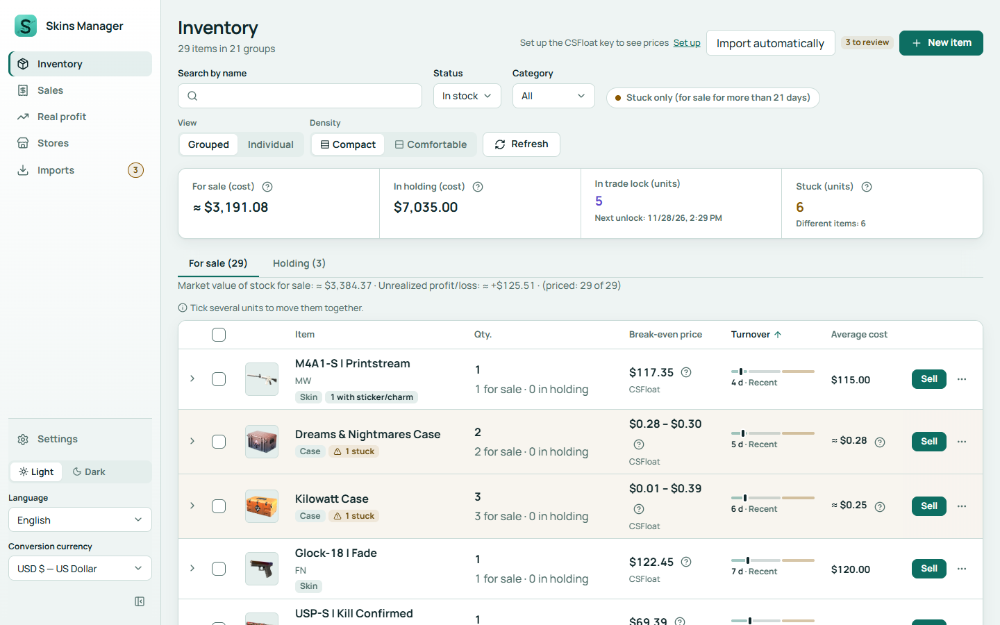
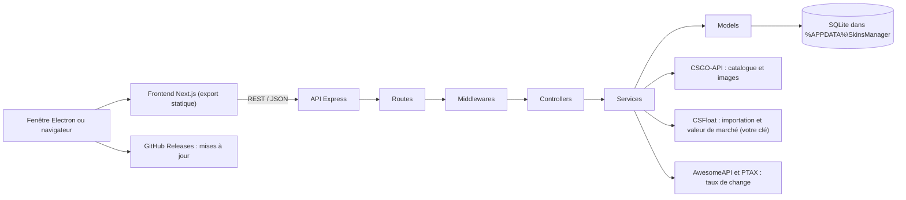

[Deutsch](README.de.md) · [English](../README.md) · [Español](README.es.md) · **Français** · [Italiano](README.it.md) · [Polski](README.pl.md) · [Português (Brasil)](README.pt-BR.md) · [Türkçe](README.tr.md) · [Русский](README.ru.md) · [Українська](README.uk.md) · [日本語](README.ja.md) · [简体中文](README.zh-CN.md) · [한국어](README.ko.md)

> Cette traduction a été réalisée avec une IA et peut contenir des erreurs. Si vous en trouvez, signalez-les dans les [Issues](https://github.com/GregoryCardoso/skins-manager/issues).

<p align="center">
  
</p>

<h1 align="center">Skins Manager</h1>

<p align="center">
  Suivez votre inventaire de skins CS2 : ce que vous avez payé, le prix le plus bas pour vendre sans perte et ce qui traîne depuis trop longtemps.
</p>

<p align="center">
  
  
  
</p>

<p align="center">
  <a href="https://github.com/GregoryCardoso/skins-manager/releases/latest"></a>
</p>

<p align="center">
  <picture>
    <source media="(prefers-color-scheme: dark)" srcset="../assets/screenshots/hero-inventory-dark.png">
    
  </picture>
</p>

<a id="contents"></a>

## Sommaire

- [Présentation](#about)
- [Fonctionnalités](#features)
- [Captures d'écran](#screens)
- [Installation](#install)
- [Mises à jour](#updates)
- [Vos données et la sauvegarde](#data)
- [Suggestions et problèmes](#feedback)
- [Mode développement](#development)
- [Architecture](#architecture)
- [Crédits](#credits)
- [Licence](#license)

<a id="about"></a>

## Présentation

Skins Manager est une **app locale** pour gérer votre inventaire CS2 : elle enregistre ce que vous avez payé pour chaque objet, affiche le prix le plus bas auquel vous pouvez vendre sans perte et signale ce qui ne se vend pas. Elle garde aussi le solde de vos boutiques et votre bénéfice réel.

- Vos données restent **uniquement sur votre ordinateur**, dans une base de données qui vous est propre. Il n'y a ni serveur ni connexion.
- Elle est gratuite pour un usage personnel, et chaque installation est personnelle.
- Elle n'a aucun lien avec Valve et ne touche pas à votre compte Steam.

<a id="features"></a>

## Fonctionnalités

<!-- demo.gif: the animated demo goes here (assets/screenshots/demo.gif) once the file exists. -->

### Inventaire

- **Catalogue d'objets avec images :** choisissez chaque objet dans une liste avec son nom et son image au lieu de tout saisir. Le catalogue est fourni avec l'app et peut être mis à jour dans les **Réglages**.
- **Float, pattern et phase :** conservez les détails de chaque skin, y compris la phase des Doppler et Gamma Doppler. Les objets que vous avez **reçus** (gratuitement) ont un coût nul.
- **Prix d'équilibre :** pour chaque boutique où vous vendez, l'app calcule le prix le plus bas qui couvre encore ce que vous avez payé, après les frais de cette boutique.
- **Trade lock :** voyez quels objets sont encore bloqués et quand ils seront débloqués.
- **Rotation :** chaque objet en vente est marqué *Récent*, *En rotation* ou *Invendu*, et vous choisissez les limites dans **Réglages → Limites de rotation**. Vous pouvez n'afficher que les invendus.
- **Deux vues :** **Groupé** (une ligne par objet, avec la quantité, le coût moyen et le coût total ; dépliez-la pour voir chaque unité) ou **Individuel**. Les onglets **En vente** et **Holding** séparent ce que vous vendez de ce que vous gardez volontairement (**Déplacer vers le holding** et **Remettre en vente** ; le compte des jours repart de zéro quand un objet est remis en vente).
- **Recherche, filtres et sélection multiple :** cherchez par nom, filtrez par état et par catégorie, triez par ancienneté et déplacez plusieurs unités vers le holding en une fois.

<p align="center">
  
</p>

### Composants et transformations

- **Stickers et breloques :** enregistrez jusqu'à 5 stickers et une breloque ou un Sticker Slab sur chaque arme, et jusqu'à 3 écussons sur chaque agent.
- **Appliquer depuis le stock :** utilisez un objet que vous possédez déjà (un sticker, une breloque ou un écusson) sur un autre ; son coût passe à l'objet, et le bénéfice réel et les soldes ne changent pas. Vous pouvez annuler.
- **Séparer la breloque/le slab :** retransformez une breloque ou un slab en unité à part entière, avec le coût réparti entre les deux.
- **Ouvrir la caisse, la capsule, le colis ou le terminal :** le coût de ce que vous avez ouvert (et de la clé de la caisse) passe à l'objet obtenu. L'objet d'un terminal peut être acheté dans votre boutique Steam, ou enregistré comme une perte.

<p align="center">
  
</p>

### Vente et Ventes

- **Vendre** un objet dans n'importe laquelle de vos boutiques : l'app affiche le prix d'équilibre et ce que vous allez recevoir, et enregistre le bénéfice.
- **Page Ventes :** bénéfice de chaque vente, délai de vente (compté à partir de la fin du trade lock), filtres par boutique et par période, et un résumé.
- **Annuler la vente** avec un aperçu de l'effet sur le solde de la boutique.

<p align="center">
  
</p>

### Bénéfice réel

- **Le solde des boutiques est calculé :** dépôts, plus ventes libérées, moins achats, moins retraits, plus ajustements. Les ventes encore retenues apparaissent comme en attente, avec leurs dates de libération.
- **Vérifier le solde :** saisissez le solde affiché sur le site de la boutique, voyez l'écart et, si vous confirmez, enregistrez un ajustement avec une note.
- **Dépôts et retraits :** enregistrez ce que vous avez mis et ce que vous avez retiré, avec les frais de chaque retrait.
- **L'équation :** la page **Bénéfice réel** montre comment le résultat est construit (retraits reçus, plus ce qui est disponible et en attente dans les boutiques, plus le stock au coût, moins le total déposé). Le stock se divise en **Stock en vente (coût)** et **Stock dans le holding (coût)**. Tout est compté en dollars américains.

<p align="center">
  
</p>

### Valeur de marché (facultatif)

- Avec une clé d'API CSFloat, l'app récupère à son ouverture le prix de référence CSFloat de vos objets (au plus toutes les 15 minutes) et affiche la **valeur de marché** et le **gain/perte latent** dans l'inventaire, dans le **Holding** et sur la page **Bénéfice réel**.
- Ce n'est qu'une **estimation** et elle **ne fait pas partie du bénéfice réel** : elle ne change ni le prix d'équilibre ni le coût du stock.

<p align="center">
  
</p>

### Importation depuis CSFloat (facultatif)

- Dans **Réglages → Intégrations**, collez votre clé d'API CSFloat (elle reste sur cet ordinateur et n'est pas incluse dans les sauvegardes) et utilisez **Importer maintenant**. L'app récupère vos achats, ventes, dépôts et retraits.
- Ce dont l'app ne peut pas être sûre va dans **Importations → À vérifier**, où vous liez, créez, conservez ou ignorez chaque entrée. **Analyse complète** relit tout l'historique, sans rien dupliquer, et **Annuler l'importation** annule un lot.
- Vous pouvez activer **Importer à l'ouverture de l'app**.

<p align="center">
  
</p>

### Boutiques

- Créez les boutiques que vous utilisez, dans n'importe laquelle des **42 devises**, chacune avec ses frais de vente (pourcentage, minimum et frais fixes, déduits du prix ou ajoutés à celui-ci), son arrondi, ses frais de retrait et la durée de rétention du solde après une vente.
- **Je vends sur cette boutique** choisit où le prix d'équilibre de chaque objet apparaît. Sur une nouvelle installation, seule CSFloat vend ; Steam et CSMoney sont fournies comme boutiques d'achat uniquement.

<p align="center">
  
</p>

### Langues, devises et réglages

- **13 langues :** English, Português (Brasil), Español, Français, Italiano, Deutsch, Polski, Türkçe, Русский, Українська, 日本語, 简体中文 et 한국어. Les noms des objets apparaissent aussi dans votre langue (c'est le nom anglais qui est enregistré). L'anglais et le portugais ont été écrits à la main ; les 11 autres ont été traduits avec une IA et peuvent contenir des erreurs.
- **Devise de conversion :** votre solde et votre bénéfice sont toujours comptés en dollars américains, et vous choisissez l'une des 42 devises pour les valeurs marquées d'un « ≈ ». Une nouvelle installation démarre en dollars, sans valeurs « ≈ ».
- **Taux de change :** saisissez le taux de n'importe quelle devise ou utilisez **Actualiser le taux**. Le taux automatique vient d'AwesomeAPI (temps réel) et, pour le réal brésilien, vous pouvez choisir à la place la PTAX de la banque centrale. Les autres devises sont mises à jour par AwesomeAPI quand elle les prend en charge, ou saisies par vous.
- **Thèmes clair et sombre**, navigation au clavier et une mise en page qui s'adapte aux petites fenêtres.
- La **sauvegarde**, les **mises à jour automatiques** et le dossier de données sont expliqués plus bas.

<p align="center">
  
</p>

<a id="screens"></a>

## Captures d'écran

Les captures sont en anglais ; l'app est dans votre langue.

<table>
  <tr>
    <td><br><sub>Inventaire (thème sombre)</sub></td>
    <td><br><sub>Inventaire (thème clair)</sub></td>
  </tr>
  <tr>
    <td><br><sub>Vue individuelle, avec float, pattern et trade lock</sub></td>
    <td><br><sub>Ajout d'un objet depuis le catalogue</sub></td>
  </tr>
  <tr>
    <td><br><sub>Vente : prix d'équilibre et montant net</sub></td>
    <td><br><sub>Ventes et délai de vente</sub></td>
  </tr>
  <tr>
    <td><br><sub>Bénéfice réel et soldes des boutiques</sub></td>
    <td><br><sub>Holding et valeur de marché</sub></td>
  </tr>
  <tr>
    <td><br><sub>Boutiques, frais et devises</sub></td>
    <td><br><sub>Importation depuis CSFloat</sub></td>
  </tr>
  <tr>
    <td><br><sub>Langue, devise de conversion et réglages</sub></td>
    <td><br><sub>Une petite fenêtre, en japonais</sub></td>
  </tr>
</table>

<a id="install"></a>

## Installation

Il y a deux façons de faire. Vos données sont les mêmes dans les deux cas.

### Option 1 : app Windows (recommandée)

Rien d'autre à installer.

1. Ouvrez la page de la dernière version : <https://github.com/GregoryCardoso/skins-manager/releases/latest>
2. Sous **Assets**, téléchargez **un** de ces fichiers :

   | Fichier | Pour qui |
   | --- | --- |
   | `SkinsManager-Setup-<version>.exe` | **Installeur (recommandé).** Installe l'app, ajoute des raccourcis sur le bureau et dans le menu Démarrer, et se met à jour tout seul (en demandant toujours avant). Il ne demande pas de mot de passe administrateur. |
   | `SkinsManager-Portable-<version>.exe` | **Portable.** N'installe rien : il suffit de double-cliquer sur le fichier. Il met un peu plus de temps à s'ouvrir et ne se met pas à jour tout seul ; il vous prévient seulement quand une nouvelle version est disponible. |

   Les autres fichiers de cette page (`latest.yml` et `.blockmap`) servent aux mises à jour automatiques. Vous n'en avez pas besoin.
3. Double-cliquez sur le fichier téléchargé.
4. **Si vous voyez « Windows a protégé votre ordinateur » (Windows protected your PC) :** cliquez sur **Informations complémentaires**, puis sur **Exécuter quand même**.
   Cet avertissement s'affiche parce que l'app n'a pas de signature numérique payante, pas parce qu'elle contient un virus. Il peut revenir à chaque nouvelle version.
   Téléchargez l'app **uniquement** depuis la page officielle ci-dessus, jamais depuis d'autres sites.

### Option 2 : dans le navigateur, à partir du code

Pour ceux qui préfèrent utiliser l'app dans un onglet du navigateur.

1. Installez **Node.js**, version **LTS**, depuis <https://nodejs.org> (il suffit de suivre l'installeur avec les options par défaut).
2. Sur la page de la dernière version (<https://github.com/GregoryCardoso/skins-manager/releases/latest>), sous **Assets**, téléchargez **Source code (zip)**.
3. Faites un clic droit sur le fichier téléchargé et choisissez **Extraire tout**. Choisissez un dossier permanent (par exemple, `Documents`).
4. Ouvrez le dossier extrait et double-cliquez sur **`start-app.bat`**.
   - La première fois, il télécharge ce dont il a besoin et prépare l'app. Cela demande internet et peut prendre quelques minutes.
   - Ensuite, l'app s'ouvre toute seule dans le navigateur, à l'adresse `http://localhost:3001`.
5. Pour fermer l'app, fermez la fenêtre noire de `start-app.bat`.

> N'ouvrez pas l'app Windows et `start-app.bat` en même temps : les deux utilisent les mêmes données, et un seul peut être ouvert.

<a id="updates"></a>

## Mises à jour

Vous voyez votre version dans **Réglages → À propos**.

- **Installeur :** quelques secondes après l'ouverture, l'app cherche une nouvelle version. Vous pouvez aussi la chercher avec le bouton **Rechercher des mises à jour**, dans **Réglages → À propos**. S'il y en a une, une fenêtre montre ce qui a changé :
  1. **Télécharger et installer** ou **Pas maintenant** (avec « Pas maintenant », l'app redemande à la prochaine ouverture). Pendant le téléchargement, **Continuer à utiliser l'app** masque la fenêtre et la progression reste dans la barre des tâches ;
  2. après le téléchargement : **Redémarrer et installer** ou **Installer à la fermeture de l'app**.
     Si vous fermez la fenêtre sans choisir, rien n'est installé : la mise à jour est proposée de nouveau à la prochaine ouverture de l'app (le fichier déjà téléchargé est réutilisé). Pour revoir la fenêtre, utilisez **Rechercher des mises à jour**.

  Rien n'est téléchargé ni installé sans votre réponse, et vos données sont conservées.
- **Portable :** l'app vous prévient de la nouvelle version, et le bouton **Ouvrir la page de téléchargement** vous mène à la bonne page. Téléchargez le nouveau fichier et utilisez-le à la place de l'ancien.
- **Dans le navigateur :** l'app ne cherche pas de nouvelles versions. Téléchargez le **Source code (zip)** de la nouvelle version, extrayez-le dans un nouveau dossier et utilisez son `start-app.bat`. Vos données restent dans `%APPDATA%\SkinsManager` ; vous pouvez ensuite supprimer l'ancien dossier.

<a id="data"></a>

## Vos données et la sauvegarde

- Elles restent **uniquement sur votre ordinateur**. Rien n'est envoyé à personne. Seul ce que vous demandez passe par internet : le catalogue d'objets et ses images, les taux de change, les fonctions CSFloat (avec votre propre clé) et la recherche de mises à jour.
- Le dossier est `%APPDATA%\SkinsManager` (en général `C:\Users\<votre utilisateur>\AppData\Roaming\SkinsManager`). L'installeur, la version portable et `start-app.bat` utilisent ce même dossier.
- **Sauvegarder :** dans **Réglages → Sauvegarde**, cliquez sur **Exporter la sauvegarde**. Gardez le fichier en lieu sûr (une clé USB ou le cloud, par exemple) et ne le partagez pas : il contient toutes vos données.
- **Restaurer :** dans **Réglages → Sauvegarde**, cliquez sur **Importer une sauvegarde** et choisissez le fichier. L'app affiche un aperçu (date, version des données et nombre d'objets, de ventes, de boutiques, de dépôts et de retraits), et vos données ne sont remplacées que lorsque vous cliquez sur **Remplacer mes données**. Avant cela, l'app conserve une copie de vos données actuelles.
- L'app fait aussi des copies automatiques avant d'importer une sauvegarde et avant de mettre à jour vos données pour une nouvelle version, et conserve les 10 plus récentes de chaque type. Le bouton **Ouvrir le dossier**, dans **Réglages → Sauvegarde**, montre où elles se trouvent.
- **Désinstaller ne supprime pas vos données.** Si vous réinstallez, tout est toujours là. Pour tout supprimer définitivement, supprimez le dossier `%APPDATA%\SkinsManager` (faites d'abord une sauvegarde si vous voulez garder quelque chose).

<a id="feedback"></a>

## Suggestions et problèmes

Vous avez trouvé un bug, une erreur de traduction ou vous avez une idée ? Ouvrez une **Issue** : <https://github.com/GregoryCardoso/skins-manager/issues> (il existe des formulaires prêts à l'emploi en portugais et en anglais).
Ne joignez pas votre fichier de sauvegarde, car il contient vos données personnelles.
Les pull requests ne sont pas acceptées pour le moment.

<a id="development"></a>

## Mode développement

<details>
<summary>Pour ceux qui veulent exécuter le code et le modifier</summary>

Prérequis : Windows, **Node.js 20 ou plus récent** et PowerShell. Dans PowerShell, utilisez `npm.cmd` à la place de `npm` si les scripts sont bloqués.

```powershell
npm.cmd run install:all     # installe les dépendances de la racine, du backend et du frontend
npm.cmd run dev             # frontend sur http://localhost:3000 et API sur http://localhost:3001
```

- **Base de données d'exemple :** `npm.cmd run seed:dev` crée une base jetable avec des données fictives dans `backend\data\inventory.dev.sqlite`, et `npm.cmd run dev:demo` lance l'app dessus. Elle n'ouvre jamais votre vraie base de données.
- **App de bureau (Electron) :** `npm.cmd run desktop:install` une fois, puis `npm.cmd run desktop:dev`. `npm.cmd run desktop:dist` génère les installeurs.
- **Tests :** `npm.cmd run test:all` exécute les suites du backend (Jest et Supertest), du frontend (Vitest) et du bureau (Jest).
- **Configuration :** les variables de `backend\.env.example` servent uniquement au développement et aux tests (par exemple, `DB_PATH` pointe vers une autre base de données). Les utilisateurs normaux ne les modifient jamais : les réglages personnels vivent dans l'app.

</details>

<a id="architecture"></a>

## Architecture

<details>
<summary>Comment l'app est construite</summary>



- **Backend :** Node.js et Express, en couches : routes, middlewares, controllers (légers), services (toute la logique métier, en général des fonctions pures qui reçoivent l'heure actuelle en paramètre) et models (uniquement du SQL).
- **Base de données :** SQLite via `better-sqlite3`, avec des migrations versionnées. Mettre à jour l'app ne supprime ni ne corrompt jamais les données, et une sauvegarde est faite avant chaque migration.
- **Frontend :** Next.js (App Router, TypeScript) avec `output: 'export'` : pages statiques, sans rendu côté serveur. Toute la logique est dans le backend, et les écrans se rafraîchissent tout seuls quand les données changent.
- **Bureau :** Electron avec electron-builder (installeur et portable) et electron-updater (GitHub Releases). Il utilise un port libre de 3001 à 3010.
- **Sécurité locale :** l'API n'accepte que les requêtes dont le `Host` est `localhost` ou `127.0.0.1`, et toute route qui modifie des données exige `Content-Type: application/json`, pour vous protéger des autres pages ouvertes dans votre navigateur.
- L'argent est stocké en centimes entiers, et les dates en ISO 8601 (UTC).

</details>

<a id="credits"></a>

## Crédits

Le catalogue d'objets et les images viennent de [CSGO-API](https://github.com/ByMykel/CSGO-API), de ByMykel.
Ce projet n'est pas affilié à Valve.

<a id="license"></a>

## Licence

L'app est **gratuite pour un usage personnel**. Le code appartient à l'auteur : **tous droits réservés**.
