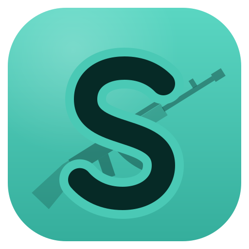
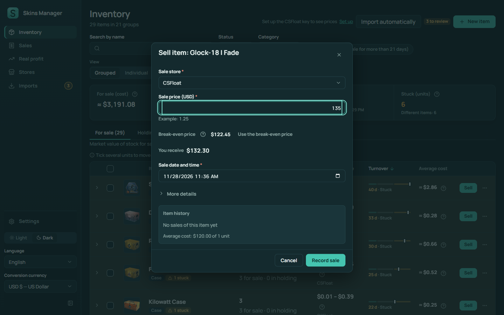
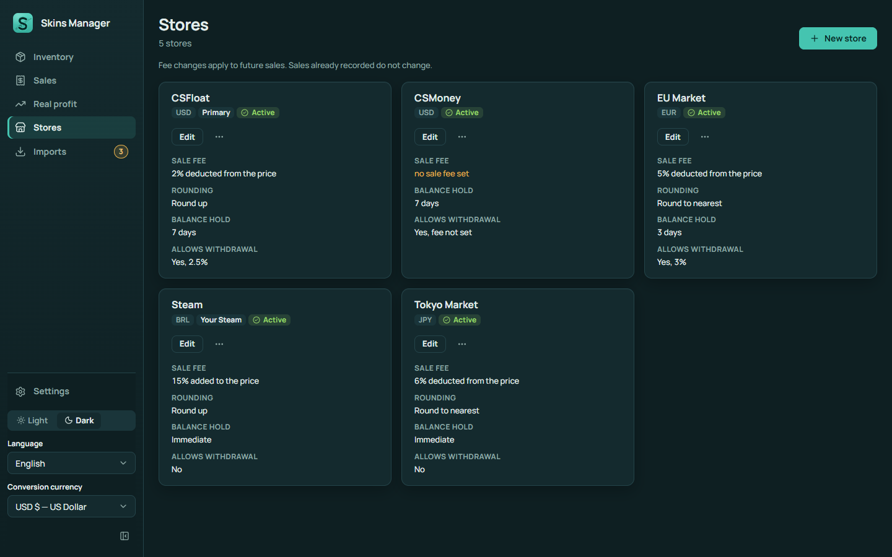
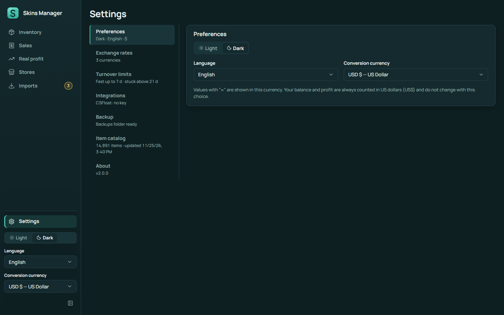
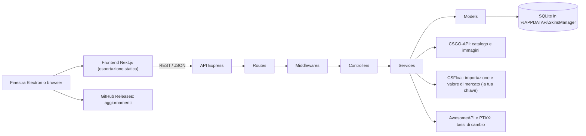

[Deutsch](README.de.md) · [English](../README.md) · [Español](README.es.md) · [Français](README.fr.md) · **Italiano** · [Polski](README.pl.md) · [Português (Brasil)](README.pt-BR.md) · [Türkçe](README.tr.md) · [Русский](README.ru.md) · [Українська](README.uk.md) · [日本語](README.ja.md) · [简体中文](README.zh-CN.md) · [한국어](README.ko.md)

> Questa traduzione è stata fatta con l'IA e può contenere errori. Se ne trovi, segnalali nelle [Issues](https://github.com/GregoryCardoso/skins-manager/issues).

<p align="center">
  
</p>

<h1 align="center">Skins Manager</h1>

<p align="center">
  Tieni traccia delle tue skin di CS2: quanto hai pagato, il prezzo più basso per vendere senza perdite e cosa è fermo da troppo tempo.
</p>

<p align="center">
  
  
  
</p>

<p align="center">
  <a href="https://github.com/GregoryCardoso/skins-manager/releases/latest"></a>
</p>

<p align="center">
  <picture>
    <source media="(prefers-color-scheme: dark)" srcset="../assets/screenshots/hero-inventory-dark.png">
    
  </picture>
</p>

<a id="contents"></a>

## Indice

- [Cos'è](#about)
- [Funzionalità](#features)
- [Schermate](#screens)
- [Installazione](#install)
- [Aggiornamenti](#updates)
- [I tuoi dati e il backup](#data)
- [Suggerimenti e problemi](#feedback)
- [Modalità di sviluppo](#development)
- [Architettura](#architecture)
- [Crediti](#credits)
- [Licenza](#license)

<a id="about"></a>

## Cos'è

Skins Manager è una **app locale** per gestire il tuo inventario di CS2: registra quanto hai pagato ogni oggetto, mostra il prezzo più basso a cui puoi vendere senza perdite e segnala ciò che non si vende. Tiene anche il saldo dei tuoi negozi e il tuo profitto reale.

- I tuoi dati restano **solo sul tuo computer**, in un database tutto tuo. Non ci sono server né login.
- È gratuita per uso personale, e ogni installazione è personale.
- Non ha alcun legame con Valve e non tocca il tuo account Steam.

<a id="features"></a>

## Funzionalità

<!-- demo.gif: the animated demo goes here (assets/screenshots/demo.gif) once the file exists. -->

### Inventario

- **Catalogo degli oggetti con immagini:** scegli ogni oggetto da un elenco con nome e immagine, invece di scrivere tutto a mano. Il catalogo è incluso nell'app e si può aggiornare in **Impostazioni**.
- **Float, pattern e fase:** conserva i dettagli di ogni skin, compresa la fase delle Doppler e Gamma Doppler. Gli oggetti che hai **ricevuto** (gratis) hanno costo zero.
- **Prezzo di pareggio:** per ogni negozio in cui vendi, l'app calcola il prezzo più basso che copre ancora quanto hai pagato, dopo la commissione di quel negozio.
- **Trade lock:** vedi quali oggetti sono ancora bloccati e quando si sbloccano.
- **Rotazione:** ogni oggetto in vendita è segnato come *Recente*, *In rotazione* o *Fermo*, e i limiti li scegli tu in **Impostazioni → Limiti di rotazione**. Puoi mostrare solo gli oggetti fermi.
- **Due viste:** **Raggruppata** (una riga per oggetto, con quantità, costo medio e costo totale; espandila per vedere ogni unità) o **Individuale**. Le schede **In vendita** e **Holding** separano ciò che stai vendendo da ciò che tieni di proposito (**Sposta in holding** e **Rimetti in vendita**; il conteggio dei giorni riparte da capo quando un oggetto torna in vendita).
- **Ricerca, filtri e selezione multipla:** cerca per nome, filtra per stato e categoria, ordina per anzianità e sposta più unità in holding in un colpo solo.

<p align="center">
  
</p>

### Componenti e trasformazioni

- **Sticker e ciondoli:** registra fino a 5 sticker e un ciondolo o Sticker Slab su ogni arma, e fino a 3 patch su ogni agente.
- **Applica dal magazzino:** usa un oggetto che hai già (uno sticker, un ciondolo o una patch) su un altro; il suo costo passa all'oggetto, e il profitto reale e i saldi non cambiano. Puoi annullare.
- **Separa ciondolo/slab:** trasforma di nuovo un ciondolo o uno slab in un'unità a sé, con il costo diviso tra i due.
- **Apri cassa, capsula, pacchetto o terminale:** il costo di ciò che hai aperto (e della chiave della cassa) passa all'oggetto che ottieni. L'oggetto di un terminale si può comprare nel tuo negozio Steam, oppure registrare come perdita.

<p align="center">
  
</p>

### Vendita e Vendite

- **Vendi** un oggetto in uno qualsiasi dei tuoi negozi: l'app mostra il prezzo di pareggio e quanto riceverai, e registra il profitto.
- **Pagina Vendite:** profitto di ogni vendita, tempo di vendita (contato dalla fine del trade lock), filtri per negozio e periodo, e un riepilogo.
- **Annulla vendita** con un'anteprima dell'effetto sul saldo del negozio.

<p align="center">
  
</p>

### Profitto reale

- **Il saldo dei negozi è calcolato:** depositi, più vendite rilasciate, meno acquisti, meno prelievi, più rettifiche. Le vendite ancora trattenute compaiono come in sospeso, con le date di rilascio.
- **Verifica il saldo:** scrivi il saldo mostrato dal sito del negozio, guarda la differenza e, se confermi, registra una rettifica con una nota.
- **Depositi e prelievi:** registra quello che hai messo e quello che hai tolto, con la commissione di ogni prelievo.
- **L'equazione:** la pagina **Profitto reale** mostra come si forma il risultato (prelievi ricevuti, più il disponibile e l'in sospeso nei negozi, più il magazzino al costo, meno il totale depositato). Il magazzino si divide in **Magazzino in vendita (costo)** e **Magazzino in holding (costo)**. Tutto è conteggiato in dollari statunitensi.

<p align="center">
  
</p>

### Valore di mercato (facoltativo)

- Con una chiave API di CSFloat, l'app recupera all'apertura il prezzo di riferimento CSFloat dei tuoi oggetti (al massimo ogni 15 minuti) e mostra il **valore di mercato** e il **profitto/perdita non realizzato** nell'inventario, in **Holding** e nella pagina **Profitto reale**.
- È solo una **stima** e **non fa parte del profitto reale**: non cambia il prezzo di pareggio né il costo del magazzino.

<p align="center">
  
</p>

### Importazione da CSFloat (facoltativa)

- In **Impostazioni → Integrazioni**, incolla la tua chiave API di CSFloat (resta su questo computer e non è inclusa nei backup) e usa **Importa ora**. L'app porta i tuoi acquisti, vendite, depositi e prelievi.
- Ciò di cui l'app non può essere sicura va in **Importazioni → Da verificare**, dove colleghi, crei, mantieni o ignori ogni voce. **Scansione completa** rilegge tutta la cronologia, senza duplicare nulla, e **Annulla l'importazione** annulla un lotto.
- Puoi attivare **Importa all'apertura dell'app**.

<p align="center">
  
</p>

### Negozi

- Crea i negozi che usi, in una qualsiasi delle **42 valute**, ognuno con la sua commissione di vendita (percentuale, minimo e commissione fissa, detratta dal prezzo o aggiunta ad esso), arrotondamento, commissioni di prelievo e trattenuta del saldo dopo una vendita.
- **Vendo in questo negozio** sceglie dove compare il prezzo di pareggio di ogni oggetto. In una nuova installazione vende solo CSFloat; Steam e CSMoney sono negozi solo per l'acquisto.

<p align="center">
  
</p>

### Lingue, valute e impostazioni

- **13 lingue:** English, Português (Brasil), Español, Français, Italiano, Deutsch, Polski, Türkçe, Русский, Українська, 日本語, 简体中文 e 한국어. Anche i nomi degli oggetti compaiono nella tua lingua (quello salvato è il nome inglese). L'inglese e il portoghese sono stati scritti a mano; le altre 11 sono state tradotte con l'IA e possono contenere errori.
- **Valuta di conversione:** il tuo saldo e il tuo profitto sono sempre conteggiati in dollari statunitensi, e tu scegli una tra 42 valute per i valori contrassegnati con "≈". Una nuova installazione parte in dollari, senza valori "≈".
- **Tassi di cambio:** scrivi il tasso di una qualsiasi valuta oppure usa **Aggiorna il tasso**. Il tasso automatico arriva da AwesomeAPI (in tempo reale) e, per il real brasiliano, puoi scegliere invece la PTAX della banca centrale. Le altre valute sono aggiornate da AwesomeAPI dove le supporta, oppure le scrivi tu.
- **Temi chiaro e scuro**, navigazione da tastiera e un layout che si adatta alle finestre piccole.
- Il **backup**, gli **aggiornamenti automatici** e la cartella dei dati sono spiegati più sotto.

<p align="center">
  
</p>

<a id="screens"></a>

## Schermate

Le schermate sono in inglese; l'app è nella tua lingua.

<table>
  <tr>
    <td><br><sub>Inventario (tema scuro)</sub></td>
    <td><br><sub>Inventario (tema chiaro)</sub></td>
  </tr>
  <tr>
    <td><br><sub>Vista individuale, con float, pattern e trade lock</sub></td>
    <td><br><sub>Aggiunta di un oggetto dal catalogo</sub></td>
  </tr>
  <tr>
    <td><br><sub>Vendita: prezzo di pareggio e importo netto</sub></td>
    <td><br><sub>Vendite e tempo di vendita</sub></td>
  </tr>
  <tr>
    <td><br><sub>Profitto reale e saldi dei negozi</sub></td>
    <td><br><sub>Holding e valore di mercato</sub></td>
  </tr>
  <tr>
    <td><br><sub>Negozi, commissioni e valute</sub></td>
    <td><br><sub>Importazione da CSFloat</sub></td>
  </tr>
  <tr>
    <td><br><sub>Lingua, valuta di conversione e impostazioni</sub></td>
    <td><br><sub>Una finestra piccola, in giapponese</sub></td>
  </tr>
</table>

<a id="install"></a>

## Installazione

Ci sono due modi. I tuoi dati sono gli stessi in entrambi.

### Opzione 1: app per Windows (consigliata)

Non serve installare altro.

1. Apri la pagina dell'ultima versione: <https://github.com/GregoryCardoso/skins-manager/releases/latest>
2. In **Assets**, scarica **uno** di questi file:

   | File | Per chi |
   | --- | --- |
   | `SkinsManager-Setup-<versione>.exe` | **Programma di installazione (consigliato).** Installa l'app, crea i collegamenti sul desktop e nel menu Start e si aggiorna da solo (chiedendo sempre prima). Non richiede la password di amministratore. |
   | `SkinsManager-Portable-<versione>.exe` | **Portatile.** Non installa nulla: basta fare doppio clic sul file. Ci mette un po' di più ad aprirsi e non si aggiorna da solo; ti avvisa soltanto quando esce una nuova versione. |

   Gli altri file di quella pagina (`latest.yml` e `.blockmap`) servono agli aggiornamenti automatici. Non ti servono.
3. Fai doppio clic sul file scaricato.
4. **Se vedi "Windows ha protetto il PC" (Windows protected your PC):** fai clic su **Ulteriori informazioni** e poi su **Esegui comunque**.
   Questo avviso compare perché l'app non ha una firma digitale a pagamento, non perché contenga un virus. Può ripresentarsi a ogni nuova versione.
   Scarica l'app **solo** dalla pagina ufficiale qui sopra, mai da altri siti.

### Opzione 2: nel browser, dal codice

Per chi preferisce usare l'app in una scheda del browser.

1. Installa **Node.js**, versione **LTS**, da <https://nodejs.org> (basta seguire il programma di installazione con le opzioni predefinite).
2. Nella pagina dell'ultima versione (<https://github.com/GregoryCardoso/skins-manager/releases/latest>), in **Assets**, scarica **Source code (zip)**.
3. Fai clic con il pulsante destro sul file scaricato e scegli **Estrai tutto**. Scegli una cartella permanente (per esempio, `Documenti`).
4. Apri la cartella estratta e fai doppio clic su **`start-app.bat`**.
   - La prima volta scarica ciò che serve e prepara l'app. Serve internet e può richiedere qualche minuto.
   - Poi l'app si apre da sola nel browser, all'indirizzo `http://localhost:3001`.
5. Per chiudere l'app, chiudi la finestra nera di `start-app.bat`.

> Non aprire l'app per Windows e `start-app.bat` contemporaneamente: usano gli stessi dati, e ne può essere aperto uno solo.

<a id="updates"></a>

## Aggiornamenti

Puoi vedere la tua versione in **Impostazioni → Informazioni**.

- **Programma di installazione:** qualche secondo dopo l'apertura, l'app cerca una nuova versione. Puoi cercarla anche con il pulsante **Cerca aggiornamenti**, in **Impostazioni → Informazioni**. Se ce n'è una, una finestra mostra cosa è cambiato:
  1. **Scarica e installa** oppure **Non ora** (con "Non ora", l'app lo richiede alla prossima apertura). Durante il download, **Continua a usare l'app** nasconde la finestra e l'avanzamento resta nella barra delle applicazioni;
  2. dopo il download: **Riavvia e installa** oppure **Installa alla chiusura dell'app**.
     Se chiudi la finestra senza scegliere, non viene installato nulla: l'aggiornamento viene riproposto alla prossima apertura dell'app (il file già scaricato viene riutilizzato). Per rivedere la finestra, usa **Cerca aggiornamenti**.

  Nulla viene scaricato o installato senza la tua risposta, e i tuoi dati vengono conservati.
- **Portatile:** l'app ti avvisa della nuova versione, e il pulsante **Apri la pagina dei download** ti porta alla pagina giusta. Scarica il nuovo file e usalo al posto del vecchio.
- **Nel browser:** l'app non cerca nuove versioni. Scarica il **Source code (zip)** della nuova versione, estrailo in una cartella nuova e usa il suo `start-app.bat`. I tuoi dati restano in `%APPDATA%\SkinsManager`; poi puoi eliminare la vecchia cartella.

<a id="data"></a>

## I tuoi dati e il backup

- Restano **solo sul tuo computer**. Non viene inviato nulla a nessuno. Su internet passa solo ciò che chiedi tu: il catalogo degli oggetti e le sue immagini, i tassi di cambio, le funzioni di CSFloat (con la tua chiave) e la ricerca degli aggiornamenti.
- La cartella è `%APPDATA%\SkinsManager` (di solito `C:\Users\<il tuo utente>\AppData\Roaming\SkinsManager`). Il programma di installazione, la versione portatile e `start-app.bat` usano questa stessa cartella.
- **Fare il backup:** in **Impostazioni → Backup**, fai clic su **Esporta il backup**. Conserva il file in un posto sicuro (una chiavetta USB o il cloud, per esempio) e non condividerlo: contiene tutti i tuoi dati.
- **Ripristinare:** in **Impostazioni → Backup**, fai clic su **Importa il backup** e scegli il file. L'app mostra un'anteprima (data, versione dei dati e quanti oggetti, vendite, negozi, depositi e prelievi contiene), e i tuoi dati vengono sostituiti solo quando fai clic su **Sostituisci i miei dati**. Prima di allora, l'app conserva una copia dei tuoi dati attuali.
- L'app fa anche copie automatiche prima di importare un backup e prima di aggiornare i dati per una nuova versione, e conserva le 10 più recenti di ogni tipo. Il pulsante **Apri la cartella**, in **Impostazioni → Backup**, mostra dove si trovano.
- **Disinstallare non cancella i tuoi dati.** Se installi di nuovo, è tutto ancora lì. Per cancellare tutto definitivamente, elimina la cartella `%APPDATA%\SkinsManager` (fai prima un backup se vuoi conservare qualcosa).

<a id="feedback"></a>

## Suggerimenti e problemi

Hai trovato un bug, un errore di traduzione o hai un'idea? Apri una **Issue**: <https://github.com/GregoryCardoso/skins-manager/issues> (ci sono moduli già pronti in portoghese e in inglese).
Non allegare il file di backup, perché contiene i tuoi dati personali.
Al momento le pull request non sono accettate.

<a id="development"></a>

## Modalità di sviluppo

<details>
<summary>Per chi vuole eseguire il codice e modificarlo</summary>

Requisiti: Windows, **Node.js 20 o successivo** e PowerShell. In PowerShell, usa `npm.cmd` al posto di `npm` se gli script sono bloccati.

```powershell
npm.cmd run install:all     # installa le dipendenze della radice, del backend e del frontend
npm.cmd run dev             # frontend su http://localhost:3000 e API su http://localhost:3001
```

- **Database di esempio:** `npm.cmd run seed:dev` crea un database usa e getta con dati fittizi in `backend\data\inventory.dev.sqlite`, e `npm.cmd run dev:demo` esegue l'app su di esso. Non apre mai il tuo database reale.
- **App desktop (Electron):** `npm.cmd run desktop:install` una volta, poi `npm.cmd run desktop:dev`. `npm.cmd run desktop:dist` genera gli installer.
- **Test:** `npm.cmd run test:all` esegue le suite del backend (Jest e Supertest), del frontend (Vitest) e del desktop (Jest).
- **Configurazione:** le variabili di `backend\.env.example` servono solo per lo sviluppo e i test (per esempio, `DB_PATH` punta a un altro database). Gli utenti normali non le modificano mai: le impostazioni personali stanno nell'app.

</details>

<a id="architecture"></a>

## Architettura

<details>
<summary>Come è costruita l'app</summary>



- **Backend:** Node.js ed Express, a livelli: routes, middlewares, controllers (sottili), services (tutte le regole di business, in genere funzioni pure che ricevono l'ora corrente come parametro) e models (solo SQL).
- **Database:** SQLite tramite `better-sqlite3`, con migrazioni versionate. Aggiornare l'app non cancella né corrompe mai i dati, e prima di ogni migrazione viene fatto un backup.
- **Frontend:** Next.js (App Router, TypeScript) con `output: 'export'`: pagine statiche, senza rendering sul server. Tutta la logica sta nel backend, e le schermate si aggiornano da sole quando i dati cambiano.
- **Desktop:** Electron con electron-builder (installer e portatile) ed electron-updater (GitHub Releases). Usa una porta libera da 3001 a 3010.
- **Sicurezza locale:** l'API accetta solo richieste il cui `Host` sia `localhost` o `127.0.0.1`, e ogni route che modifica dati richiede `Content-Type: application/json`, per proteggerti da altre pagine aperte nel browser.
- Il denaro è memorizzato in centesimi interi, e le date in ISO 8601 (UTC).

</details>

<a id="credits"></a>

## Crediti

Il catalogo degli oggetti e le immagini provengono da [CSGO-API](https://github.com/ByMykel/CSGO-API), di ByMykel.
Questo progetto non è affiliato a Valve.

<a id="license"></a>

## Licenza

L'app è **gratuita per uso personale**. Il codice appartiene all'autore: **tutti i diritti riservati**.
