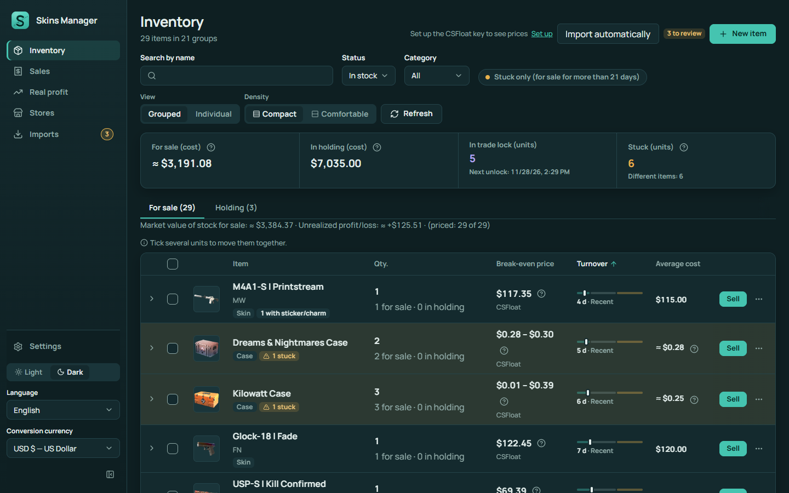
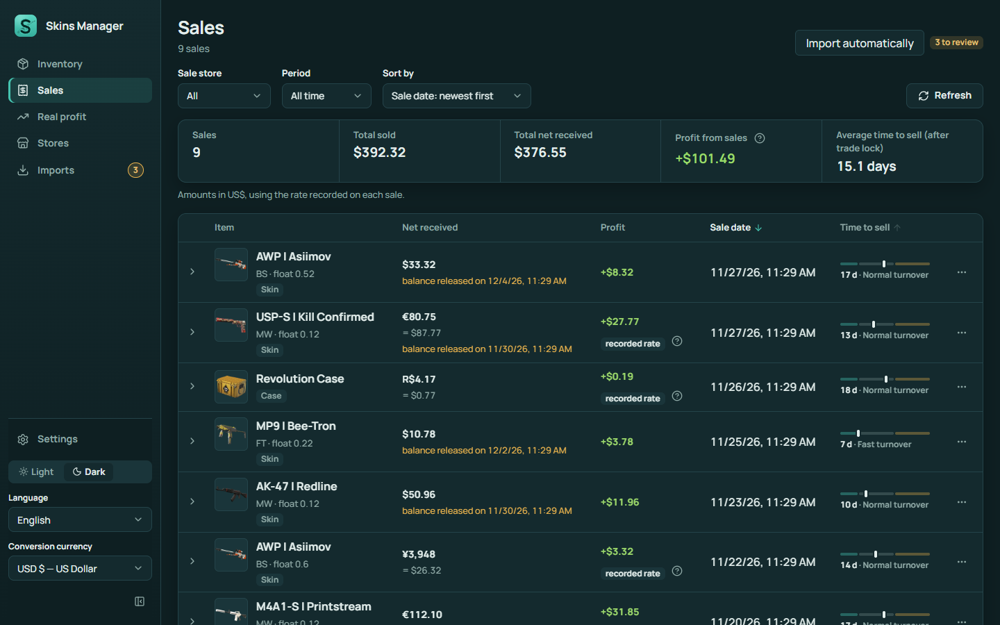
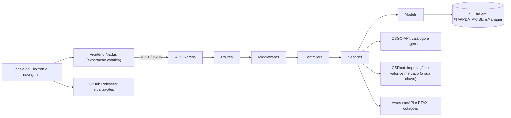

[Deutsch](README.de.md) · [English](../README.md) · [Español](README.es.md) · [Français](README.fr.md) · [Italiano](README.it.md) · [Polski](README.pl.md) · **Português (Brasil)** · [Türkçe](README.tr.md) · [Русский](README.ru.md) · [Українська](README.uk.md) · [日本語](README.ja.md) · [简体中文](README.zh-CN.md) · [한국어](README.ko.md)

<p align="center">
  
</p>

<h1 align="center">Skins Manager</h1>

<p align="center">
  Controle o seu inventário de skins de CS2: quanto pagou, por quanto vender sem prejuízo e o que está parado há tempo demais.
</p>

<p align="center">
  
  
  
</p>

<p align="center">
  <a href="https://github.com/GregoryCardoso/skins-manager/releases/latest"></a>
</p>

<p align="center">
  <picture>
    <source media="(prefers-color-scheme: dark)" srcset="../assets/screenshots/hero-inventory-dark.png">
    
  </picture>
</p>

<a id="contents"></a>

## Índice

- [O que é](#about)
- [Funcionalidades](#features)
- [Prints](#screens)
- [Instalação](#install)
- [Atualização](#updates)
- [Seus dados e o backup](#data)
- [Sugestões e problemas](#feedback)
- [Modo de desenvolvimento](#development)
- [Arquitetura](#architecture)
- [Créditos](#credits)
- [Uso](#license)

<a id="about"></a>

## O que é

O Skins Manager é um **app local** para controlar o seu inventário de CS2: registra quanto você pagou em cada item, mostra o menor preço pelo qual dá para vender sem prejuízo e aponta o que não está vendendo. Ele também guarda o saldo das suas lojas e o seu lucro real.

- Os seus dados ficam **só no seu computador**, num banco de dados seu. Não há servidor nem login.
- É livre para uso pessoal, e cada instalação é pessoal.
- Não tem ligação com a Valve e não mexe na sua conta da Steam.

<a id="features"></a>

## Funcionalidades

<!-- demo.gif: o GIF de demonstração entra aqui (assets/screenshots/demo.gif) quando o arquivo existir. -->

### Inventário

- **Catálogo de itens com imagem:** escolha o item numa lista com nome e imagem, sem digitar tudo à mão. O catálogo vem com o app e pode ser atualizado em **Configurações**.
- **Float, pattern e fase:** guarde os detalhes de cada skin, incluindo a fase das Doppler e Gamma Doppler. Itens que você **ganhou** (de graça) têm custo zero.
- **Preço mínimo sem prejuízo:** para cada loja onde você vende, o app calcula o menor preço que ainda cobre o que você pagou, já descontando a taxa dessa loja.
- **Trade lock:** veja quais itens ainda estão bloqueados e quando são liberados.
- **Giro:** cada item à venda é marcado como *Recente*, *Em giro* ou *Encalhado*, e você escolhe os limites em **Configurações → Limites de giro**. Dá para mostrar só os encalhados.
- **Duas visões:** **Agrupado** (uma linha por item, com quantidade, custo médio e custo total; expanda para ver cada unidade) ou **Individual**. As abas **À venda** e **Holding** separam o que você está vendendo do que está guardando de propósito (**Mover para o holding** e **Voltar para a venda**; a contagem dos dias recomeça quando o item volta para a venda).
- **Busca, filtros e seleção em massa:** busque pelo nome, filtre por situação e categoria, ordene por idade e mova várias unidades para o holding de uma vez.

<p align="center">
  
</p>

### Componentes e transformações

- **Stickers e chaveiros:** registre até 5 stickers e um chaveiro ou Sticker Slab em cada arma, e até 3 patches em cada agente.
- **Aplicar do estoque:** use um item que você já tem (sticker, chaveiro ou patch) em outro; o custo dele passa para o item, e o lucro real e os saldos não mudam. Dá para desfazer.
- **Separar chaveiro/slab:** transforme um chaveiro ou slab de novo em uma unidade própria, com o custo dividido entre os dois.
- **Abrir caixa, cápsula, pacote ou terminal:** o custo do que você abriu (e da chave da caixa) passa para o item que você recebeu. O item de um terminal pode ser comprado na sua loja Steam, ou registrado como perda.

<p align="center">
  
</p>

### Venda e Vendas

- **Vender** um item em qualquer das suas lojas: o app mostra o preço mínimo e quanto você vai receber, e registra o lucro.
- **Página Vendas:** lucro de cada venda, tempo até vender (contado do fim do trade lock), filtros por loja e período e um resumo.
- **Desfazer venda** com uma prévia do efeito no saldo da loja.

<p align="center">
  
</p>

### Lucro real

- **O saldo das lojas é calculado:** aportes, mais vendas liberadas, menos compras, menos saques, mais ajustes. As vendas que ainda estão retidas aparecem como pendentes, com as datas de liberação.
- **Conferir saldo:** digite o saldo que o site da loja mostra, veja a diferença e, se você confirmar, registre um ajuste com observação.
- **Aportes e saques:** registre o que você colocou e o que tirou, com a taxa de cada saque.
- **A equação:** a página **Lucro real** mostra como o resultado é formado (saques recebidos, mais o disponível e o pendente nas lojas, mais o estoque pelo custo, menos o total colocado). O estoque se divide em **Estoque à venda (custo)** e **Estoque em holding (custo)**. Tudo é contado em dólar.

<p align="center">
  
</p>

### Valor de mercado (opcional)

- Com uma chave da API do CSFloat, o app busca o preço de referência dos seus itens no CSFloat quando abre (no máximo a cada 15 minutos) e mostra o **valor de mercado** e o **lucro/prejuízo não realizado** no inventário, no **Holding** e na página **Lucro real**.
- É só uma **estimativa** e **não entra no lucro real**: não muda o preço mínimo nem o custo do estoque.

<p align="center">
  
</p>

### Importação do CSFloat (opcional)

- Em **Configurações → Integrações**, cole a sua chave da API do CSFloat (ela fica só neste computador e não vai para os backups) e use **Importar agora**. O app traz as suas compras, vendas, aportes e saques.
- O que o app não tem certeza vai para **Importações → Para conferir**, onde você liga, cria, mantém ou ignora cada lançamento. A **Varredura completa** lê todo o histórico de novo, sem duplicar nada, e **Desfazer importação** reverte um lote.
- Dá para ligar **Importar ao abrir o app**.

<p align="center">
  
</p>

### Lojas

- Cadastre as lojas que você usa, em qualquer das **42 moedas**, cada uma com a sua taxa de venda (percentual, taxa mínima e taxa fixa, descontada do preço ou somada a ele), arredondamento, taxas de saque e retenção do saldo após a venda.
- **Vendo nesta loja** escolhe onde o preço mínimo de cada item aparece. Numa instalação nova só a CSFloat vende; a Steam e a CSMoney vêm como lojas só de compra.

<p align="center">
  
</p>

### Idiomas, moedas e configurações

- **13 idiomas:** English, Português (Brasil), Español, Français, Italiano, Deutsch, Polski, Türkçe, Русский, Українська, 日本語, 简体中文 e 한국어. Os nomes dos itens também aparecem no seu idioma (o nome em inglês é o que fica gravado). O inglês e o português foram escritos à mão; os outros 11 foram traduzidos com IA e podem ter erros.
- **Moeda de conversão:** o seu saldo e o seu lucro são sempre contados em dólar, e você escolhe uma entre 42 moedas para os valores marcados com "≈". Uma instalação nova começa em dólar, sem valores "≈".
- **Cotações:** digite a cotação de qualquer moeda ou use **Atualizar cotação**. A cotação automática vem da AwesomeAPI (tempo real) e, para o real, dá para escolher a PTAX do Banco Central. As outras moedas são atualizadas pela AwesomeAPI onde ela atende, ou digitadas por você.
- **Tema claro e escuro**, navegação pelo teclado e um layout que se adapta a janelas pequenas.
- **Backup**, **atualização automática** e a pasta de dados estão explicados mais abaixo.

<p align="center">
  
</p>

<a id="screens"></a>

## Prints

Os prints estão em inglês; o app fica no seu idioma.

<table>
  <tr>
    <td><br><sub>Inventário (tema escuro)</sub></td>
    <td><br><sub>Inventário (tema claro)</sub></td>
  </tr>
  <tr>
    <td><br><sub>Visão individual, com float, pattern e trade lock</sub></td>
    <td><br><sub>Cadastro de um item pelo catálogo</sub></td>
  </tr>
  <tr>
    <td><br><sub>Venda: preço mínimo e valor líquido</sub></td>
    <td><br><sub>Vendas e tempo até vender</sub></td>
  </tr>
  <tr>
    <td><br><sub>Lucro real e saldos das lojas</sub></td>
    <td><br><sub>Holding e valor de mercado</sub></td>
  </tr>
  <tr>
    <td><br><sub>Lojas, taxas e moedas</sub></td>
    <td><br><sub>Importação do CSFloat</sub></td>
  </tr>
  <tr>
    <td><br><sub>Idioma, moeda de conversão e configurações</sub></td>
    <td><br><sub>Uma janela pequena, em japonês</sub></td>
  </tr>
</table>

<a id="install"></a>

## Instalação

Existem duas formas. Os seus dados são os mesmos nas duas.

### Opção 1: app para Windows (recomendado)

Não precisa instalar mais nada.

1. Abra a página da versão mais recente: <https://github.com/GregoryCardoso/skins-manager/releases/latest>
2. Em **Assets**, baixe **um** destes arquivos:

   | Arquivo | Para quem |
   | --- | --- |
   | `SkinsManager-Setup-<versão>.exe` | **Instalador (recomendado).** Instala o app, cria atalho na área de trabalho e no menu Iniciar e se atualiza sozinho (sempre perguntando antes). Não pede senha de administrador. |
   | `SkinsManager-Portable-<versão>.exe` | **Portátil.** Não instala nada: é só dar dois cliques no arquivo. Demora um pouco mais para abrir e não se atualiza sozinho; ele só avisa quando sai uma versão nova. |

   Os outros arquivos da página (`latest.yml` e `.blockmap`) são usados pela atualização automática. Você não precisa deles.
3. Dê dois cliques no arquivo baixado.
4. **Se aparecer "O Windows protegeu o computador":** clique em **Mais informações** e depois em **Executar assim mesmo**.
   Esse aviso aparece porque o app não tem uma assinatura digital paga, não porque tem vírus. Ele pode voltar a cada versão nova.
   Baixe o app **somente** pela página oficial acima, nunca de outros sites.

### Opção 2: no navegador, pelo código

Para quem prefere usar o app numa aba do navegador.

1. Instale o **Node.js**, versão **LTS**, em <https://nodejs.org> (é só seguir o instalador com as opções padrão).
2. Na página da versão mais recente (<https://github.com/GregoryCardoso/skins-manager/releases/latest>), em **Assets**, baixe o **Source code (zip)**.
3. Clique com o botão direito no arquivo baixado e escolha **Extrair tudo**. Escolha uma pasta fixa (por exemplo, `Documentos`).
4. Abra a pasta extraída e dê dois cliques em **`start-app.bat`**.
   - Na primeira vez, ele baixa o que precisa e prepara o app. Isso exige internet e pode levar alguns minutos.
   - Depois, o app abre sozinho no navegador, em `http://localhost:3001`.
5. Para fechar o app, feche a janela preta do `start-app.bat`.

> Não abra o app para Windows e o `start-app.bat` ao mesmo tempo: os dois usam os mesmos dados, e só um pode ficar aberto.

<a id="updates"></a>

## Atualização

Você vê a sua versão em **Configurações → Sobre**.

- **Instalador:** alguns segundos depois de abrir, o app procura uma versão nova. Também dá para procurar pelo botão **Verificar atualizações**, em **Configurações → Sobre**. Se houver novidade, uma janela mostra o que mudou:
  1. **Baixar e instalar** ou **Agora não** (com "Agora não", ele pergunta de novo na próxima vez que você abrir o app). Enquanto baixa, **Continuar usando o app** esconde a janela e o progresso fica na barra de tarefas;
  2. depois do download: **Reiniciar e instalar** ou **Instalar ao fechar o app**.
     Se você fechar a janela sem escolher, nada é instalado: a atualização é oferecida de novo na próxima abertura (o arquivo já baixado é reaproveitado). Para ver a janela outra vez, use **Verificar atualizações**.

  Nada é baixado nem instalado sem a sua resposta, e os seus dados são mantidos.
- **Portátil:** o app avisa da versão nova, e o botão **Abrir página de download** leva à página certa. Baixe o novo arquivo e use-o no lugar do antigo.
- **No navegador:** o app não procura versões novas. Baixe o **Source code (zip)** da versão nova, extraia numa pasta nova e use o `start-app.bat` dela. Os seus dados continuam em `%APPDATA%\SkinsManager`; depois, você pode apagar a pasta antiga.

<a id="data"></a>

## Seus dados e o backup

- Ficam **só no seu computador**. Nada é enviado a ninguém. O que vai à internet é só o que você pede: o catálogo de itens e as imagens, as cotações, os recursos do CSFloat (com a sua própria chave) e a procura por atualizações.
- A pasta é `%APPDATA%\SkinsManager` (normalmente `C:\Users\<seu usuário>\AppData\Roaming\SkinsManager`). O instalador, o portátil e o `start-app.bat` usam essa mesma pasta.
- **Fazer backup:** em **Configurações → Backup**, clique em **Exportar backup**. Guarde o arquivo num lugar seguro (um pen drive ou a nuvem, por exemplo) e não o compartilhe: ele contém todos os seus dados.
- **Restaurar:** em **Configurações → Backup**, clique em **Importar backup** e escolha o arquivo. O app mostra uma prévia (data, versão dos dados e quantos itens, vendas, lojas, aportes e saques o arquivo tem), e só quando você clica em **Substituir meus dados** os seus dados são trocados. Antes disso, o app guarda uma cópia dos dados atuais.
- O app também faz cópias automáticas antes de importar um backup e antes de atualizar os dados para uma versão nova, e guarda as 10 mais recentes de cada tipo. O botão **Abrir pasta**, em **Configurações → Backup**, mostra onde elas ficam.
- **Desinstalar não apaga os seus dados.** Se instalar de novo, tudo continua lá. Para apagar tudo de vez, exclua a pasta `%APPDATA%\SkinsManager` (faça um backup antes, se quiser guardar algo).

<a id="feedback"></a>

## Sugestões e problemas

Encontrou um erro, um erro de tradução ou tem uma ideia? Abra uma **Issue**: <https://github.com/GregoryCardoso/skins-manager/issues> (há formulários prontos em português e inglês).
Não anexe o seu arquivo de backup, porque ele contém os seus dados pessoais.
Pull requests não são aceitos no momento.

<a id="development"></a>

## Modo de desenvolvimento

<details>
<summary>Para quem quer rodar o código e alterá-lo</summary>

Requisitos: Windows, **Node.js 20 ou mais novo** e PowerShell. No PowerShell, use `npm.cmd` no lugar de `npm` se os scripts estiverem bloqueados.

```powershell
npm.cmd run install:all     # instala as dependências da raiz, do backend e do frontend
npm.cmd run dev             # frontend em http://localhost:3000 e API em http://localhost:3001
```

- **Banco de exemplo:** `npm.cmd run seed:dev` cria um banco descartável com dados fictícios em `backend\data\inventory.dev.sqlite`, e `npm.cmd run dev:demo` roda o app nele. O seu banco real nunca é aberto.
- **App desktop (Electron):** `npm.cmd run desktop:install` uma vez, depois `npm.cmd run desktop:dev`. O `npm.cmd run desktop:dist` gera os instaladores.
- **Testes:** `npm.cmd run test:all` roda as suítes do backend (Jest e Supertest), do frontend (Vitest) e do desktop (Jest).
- **Configurações:** as variáveis de `backend\.env.example` servem só para desenvolvimento e testes (por exemplo, `DB_PATH` aponta para outro banco). O usuário comum nunca as edita: as configurações pessoais ficam no app.

</details>

<a id="architecture"></a>

## Arquitetura

<details>
<summary>Como o app é construído</summary>



- **Backend:** Node.js e Express, em camadas: rotas, middlewares, controllers (finos), services (toda a regra de negócio, em geral funções puras que recebem a hora atual como parâmetro) e models (só SQL).
- **Banco:** SQLite pelo `better-sqlite3`, com migrações versionadas. Atualizar o app nunca apaga nem corrompe dados, e um backup é feito antes de cada migração.
- **Frontend:** Next.js (App Router, TypeScript) com `output: 'export'`: páginas estáticas, sem renderização no servidor. Toda a lógica fica no backend, e as telas se atualizam sozinhas quando os dados mudam.
- **Desktop:** Electron com electron-builder (instalador e portátil) e electron-updater (GitHub Releases). Ele usa uma porta livre de 3001 a 3010.
- **Segurança local:** a API só aceita requisições cujo `Host` seja `localhost` ou `127.0.0.1`, e toda rota que altera dados exige `Content-Type: application/json`, para proteger você de outras páginas abertas no navegador.
- Valores monetários em centavos inteiros e datas em ISO 8601 (UTC).

</details>

<a id="credits"></a>

## Créditos

O catálogo e as imagens dos itens vêm da [CSGO-API](https://github.com/ByMykel/CSGO-API), de ByMykel.
Este projeto não tem ligação com a Valve.

<a id="license"></a>

## Uso

O app é **livre para uso pessoal**. O código pertence ao autor: **todos os direitos reservados**.
